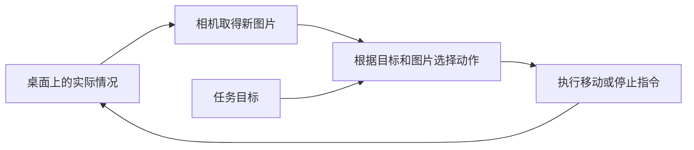
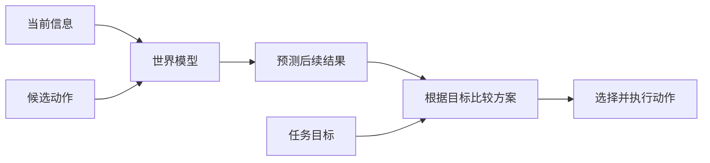

# 第 01 章　从一个桌面任务认识整本书

上一章：无，本章是起点 · [全书目录](../../README.md) · 下一章：[第02章：电脑、文件、命令行与第一个程序](../02-computer-and-environment/README.md)

**阅读顺序：本章正文 → [练习与自测](exercises.md) → [参考答案](solutions.md)。**

本章状态：正文、练习与答案已完成。核验日期：2026-10-24。本章采用纸面案例，不包含需要安装或运行的程序。

## 1.1 你从哪里开始，要学会什么

假设现在给你一台机器人，你对它说：

> 把红色方块移到蓝色区域里。

这句话很短。你自己做的时候，可能看看桌面、伸手移动一下，就完成了。可如果让机器人完成，它必须解决好几个不同的问题：哪个是红色方块？蓝色区域在哪里？它的手能怎么动？移动过程中方块有没有滑走？什么时候应该停下？

整本书会逐步教你把这些问题变成计算机能够处理的问题。这一章先带你看清整个任务，再认识具身智能、VLM、VLA 和世界模型各自的用途。

你不需要提前会编程，也不需要知道矩阵、导数或神经网络是什么。后面的基础章节会按顺序解释。现在的目标是：看完一个具体例子，能够用自己的话说出“它需要知道什么、做什么、检查什么”。

完成本章后，你应该能够：

1. 说明为什么机器人需要在行动后继续观察。
2. 用桌面任务分别解释四个核心概念。
3. 区分文字建议、动作指令、未来预测和实际结果。
4. 说明为什么在电脑里的虚拟环境也可以开展具身智能研究。

## 1.2 先把任务说清楚

### 桌面上有什么

想象你从上方看一张桌子。左边有一个红色方块，下方还有一个绿色方块，右边画着一个蓝色方框。蓝色方框是目标区域，不是需要搬走的物体。

| 桌面位置 | 物体或区域 | 在这次任务中的作用 |
| --- | --- | --- |
| 左侧 | 红色方块 | 要移动的物体 |
| 下方 | 绿色方块 | 不需要移动的物体 |
| 右侧 | 蓝色方框 | 红色方块应该到达的区域 |

机器人旁边装着一台相机，可以拍到桌面；它还有一个可以移动物体的机械装置。为了把第一个例子讲清楚，暂时假设它已经具有移动方块的基本能力。如何让机械装置真的动起来，会在后面的机器人章节中教。

我们约定这次任务的成功条件：**红色方块完全进入蓝色区域并停住，绿色方块保持原位。**

为什么要加这句话？因为“移到里面”可能有不同理解。红色方块只有一个角碰到蓝线，算完成吗？它经过蓝色区域后继续滑了出去，算完成吗？先约定成功条件，才能判断后面的方法到底有没有做好。

### 从人的操作中找出需要解决的问题

你会先找到红色方块，再找到蓝色区域，接着考虑怎样移动。移动到一半时，你通常还会继续看：有没有偏？还差多远？是否应该减慢？

我们给这几个日常动作起几个技术名称。每个词先记住这里的意思即可。

| 日常说法 | 本书使用的名称 | 准确一点的解释 |
| --- | --- | --- |
| 看看现在是什么情况 | 观测（observation） | 系统通过相机等设备取得的信息；本例中可以是一张桌面图片 |
| 从图片里找出方块和目标 | 感知（perception） | 从取得的信息中辨认与任务有关的内容 |
| 决定下一步怎样做 | 决策（decision-making） | 根据已有信息和目标选择行动 |
| 让机械装置移动 | 动作（action） | 系统发给执行装置、用于影响环境的指令 |
| 动完后看看发生了什么 | 反馈（feedback） | 行动之后获得的信息，可用于判断结果并调整后续行为 |

相机只是拍到了图片，它不会因为拍照就自动知道“这个方块是目标”。辨认图片中的内容是接下来的处理过程。同样，系统发出了移动指令，也不意味着方块就一定按照预期移动。

这两处区别会贯穿整本书：**拿到信息之后，还需要理解；发出动作之后，还需要检查。**

## 1.3 为什么要“再看一眼”

### 一次看完就行动，会遇到什么问题

假设机器人看过桌面后，决定把红色方块向右移动一段距离。可桌面比较光滑，方块比预期多滑了一点；或者有人碰了一下桌子，方块的位置发生了变化。

如果机器人始终只按最开始的图片行动，它使用的就是过时的信息。它可能已经走偏，却还在继续执行原来的动作。

更合适的做法是：移动一点，取得新的观察，根据新情况决定下一步。比如发现方块已经到达蓝色区域，就停止移动；发现它向下偏了，就修正方向。

### 这就是反馈回路

可以把它理解为骑自行车时不断看路、调整车把。你不需要在出发前一次性算出整段路上每一秒的车把角度，而是在前进中不断修正。

准确地说，**当行动产生的结果通过新的观测影响后续行动时，系统形成了反馈回路，也称闭环（closed loop）。** 如果执行动作期间没有利用结果来调整，这段执行可以称为开环（open loop）。

**图1-1　观察与行动形成回路。** 箭头表示谁会影响下一步。即使阅读器没有显示图，也可以按这句话理解：桌面情况影响图片，图片和目标影响动作，动作又影响桌面情况。

这里的“回路”不表示系统每次都必须移动。选择停止、等待或重新观察，也可以是合理的决定。

闭环有助于纠正偏差，但它不能保证任务一定成功。如果相机把绿色方块看成红色方块，系统可能一直在非常认真地移动错误的物体。我们还需要检查每个环节是否可靠。

### 观测也可能不完整

如果机械装置挡住了红色方块，相机暂时看不到它，方块会因此从世界上消失吗？当然不会。

这说明：**环境里实际存在的情况，比系统此刻能够观察到的信息更多。** 系统有时需要利用之前看到的内容，或换一个位置再观察。后面会专门学习这类问题；本章只要记住“看不见”不等于“不存在”。

## 1.4 “具身智能”关注的是什么

### 先用一句日常话理解

具身智能关注的是：一个会感知、能行动的系统，怎样利用自己的身体和周围环境完成任务。

拿人作比喻，你移动方块时，眼睛能看到哪里、手能伸到哪里、手指能怎样用力，都会影响你的做法。换成一个只有推杆、没有手指的装置，它完成同一任务的方式可能就不同。

这个比喻用来帮助理解身体的作用，并不意味着机器人拥有人的意识或感觉。

### 给出本书使用的定义

先认识两个词：

- **环境（environment）**：系统能够观察或影响的外部世界。在本例中，包括桌面、方块、目标区域等。
- **智能体（agent）**：能够接收信息并选择行动的系统。在本例中，是具有感知和行动能力的机器人系统。

本书将**具身智能（embodied intelligence；在人工智能领域也常称 embodied AI）**理解为：研究具有实体或虚拟身体的智能体，如何通过感知与行动和环境交互，以完成任务的能力与方法。

其中的“身体”会决定它能感知什么、做出哪些动作，以及受到哪些限制。具身智能研究因此也会关注这些限制如何影响学习和行为。Habitat 的官方介绍同样把实体或虚拟身体、智能体与环境的交互作为这一领域的重要内容。[来源：AI Habitat](https://aihabitat.org/)

这也意味着，具身智能是一个研究方向，包含感知、行动、学习和系统集成等问题。它不像某个具体程序那样，只有固定的一套输入输出。

### 为什么身体会改变解决方案

比较两个装置：

| 装置 | 能做什么 | 面对红色方块时需要考虑什么 |
| --- | --- | --- |
| 只能沿桌面移动的推杆 | 从侧面推动物体 | 从哪一侧接触、推动后物体怎样滑动 |
| 能抓取并抬起物体的机械手 | 抓起、搬运、放下 | 怎样抓稳、能否抬起、放下的位置是否合适 |

同一句“移到蓝色区域”，对于这两个装置，合适的动作可能完全不同。只理解句子的文字，还不足以确定具体应该怎么做。

不过，也不能根据外形直接判断智能水平。一个像人的机器人可能只能重复固定动作；一个只有小推杆的装置，也可以根据新观察调整行为。判断时需要看实际能力和实验结果。

## 1.5 在介绍 VLM 之前，先解释“模型”

生活中的地图保留了道路关系，却省略了每棵树、每块石头。它是一种对现实的简化表示，能帮助我们判断路线。

在本书中，**模型（model）**通常指用数学关系和计算程序表示某些规律的工具。你给它一些信息，它按照自身表示的规律得到一个结果。

给模型的信息叫**输入（input）**，模型产生的结果叫**输出（output）**。例如，把一张图片交给一个识别工具是输入；工具返回“图片里有一个红色方块”是输出。

有些规律由人写好。有些模型则通过大量例子调整内部设置，这个过程叫**训练（training）**。例如，把许多图片和对应的物体名称提供给模型，让它逐步学会图片与名称的对应关系。

训练后，把新图片交给模型，让它产生结果，叫**推理（inference）**。这里的“推理”是使用模型的技术名称，并不表示它一定进行了像人一样的逻辑思考，也不表示结果一定正确。

本章不需要知道内部设置如何调整。你只要区分：训练是在例子中调整模型，推理是在具体输入上使用模型。一次行动后取得反馈，也不一定会立即重新训练；系统可以只根据新图片重新选择动作。

地图的比喻也有边界：计算模型未必保存一张人能直接读懂的地图，它保存规律的方式可以很不同。

## 1.6 VLM：把图像与语言联系起来

### 从“看图回答”开始

假设有一个助手，你给它桌面照片，再问：“红色方块在哪里？”它可能回答：“在图片左侧。”你再问：“需要把哪个物体移到蓝色区域？”它可能回答：“红色方块。”

这类能力涉及两种信息：图片和语言。像图片、文字、声音这样的信息形式，常被称为不同的**模态（modality）**。同时处理多种信息形式，就叫多模态。

**VLM** 是 **Vision-Language Model** 的缩写，中文称为**视觉-语言模型**。从广义上说，它是一类建立视觉信息与语言信息之间联系的模型。

有些 VLM 用于比较一张图片和一段文字是否匹配；有些可以根据图片与问题生成文字回答。本书后面会分别学习这些用法。本章主要用“看图回答”的形式建立直觉。LLaVA 是后者的一个代表研究案例。[来源：Visual Instruction Tuning](https://arxiv.org/abs/2304.08485)

### 在桌面任务中，它能帮助什么

我们可以设想以下输入输出。这里是用于说明用途的教学例子，不是已经运行某个模型得到的结果。

| 输入 | 可能的输出 |
| --- | --- |
| 桌面照片 + “哪个物体是红色的？” | “左边的方块。” |
| 桌面照片 + “红色方块已经完全进入蓝色区域了吗？” | “还没有，它的一部分在区域外。” |
| 桌面照片 + “请描述任务涉及的物体。” | “需要移动红色方块，目标是蓝色区域。” |

这些输出可以为系统提供帮助，但也可能出错。例如，光照影响颜色，或者相机拍摄角度让边界难以看清。因此实际使用中要检查它在具体任务上的表现。

### 能说清动作，是否就能执行动作

假设模型回答：“向右移动一点。”这句话对人有意义，但机器人还需要知道：以谁的方向为右？移动多远？移动机械装置的哪一部分？

**文字建议还需要转换成执行装置能够接受的指令。** 完整系统可以使用 VLM 产生建议，再由其他程序完成转换。是否能够最终完成任务，需要检查整套系统。

所以，看到一个模型可以正确描述图片，我们可以说它在这次看图任务上表现正确；要证明它能够控制机器人，还需要行动与任务结果方面的证据。

## 1.7 VLA：根据视觉和语言产生动作

### 让输出接近“下一步怎么动”

现在设想另一个助手。它看到桌面图片，也收到“把红色方块移到蓝色区域”的指令。它提供的结果用于告诉机器人下一步怎样行动。

**VLA** 是 **Vision-Language-Action** 的缩写，中文常称为**视觉-语言-动作模型**。本书用它指：根据视觉观测、语言指令，以及某些模型还会使用的机器人自身信息，产生机器人动作或动作序列的模型。

其中“动作序列”就是按先后排列的一组动作。现在只需理解这个意思，具体怎样表示会在后续章节学习。OpenVLA 是公开研究中的一个 VLA 案例，它将视觉语言信息与机器人动作学习联系起来。[来源：OpenVLA](https://arxiv.org/abs/2406.09246)

### 一个经过简化的动作接口

为了说明文字建议与动作输出的差别，假设我们提前给装置规定了一个很简单的接口。这里的**接口（interface）**，可以理解为双方约定好的沟通格式：程序按这个格式给指令，装置按约定解释它。

本例约定桌面右侧就是“右”，装置当前已经接触到红色方块，指令可以包含：

| 指令字段 | 示例值 | 约定的含义 |
| --- | --- | --- |
| 移动方向 | 右 | 朝图中已经约定的桌面右侧移动 |
| 移动距离 | 2厘米 | 请求装置移动这一距离 |
| 停止 | 否 | 此次请求执行移动 |

这张表仅是教学用的简化接口。真实 VLA 的动作可能是关节变化、机械手的位置变化或其他格式，不存在适用于所有机器人的统一三字段格式。

而且“请求移动2厘米”仍然是动作指令。方块实际上移动了多少，要通过新的观测检查。输出动作的模型和真正完成动作的机械装置，是完整系统中的不同部分。

### VLA 也需要置于完整系统中

机器人还需要拍照、整理输入、执行指令并继续观察。这个过程可以反复运行：

> 新图片与任务指令 → VLA 产生动作 → 装置执行 → 取得新图片。

在这个过程中，**控制（control）**可以先理解为“让机械装置按期望方式运动，并在需要时纠正偏差”。更具体的控制程序通常负责把较高层的动作要求落实到装置上。后面会系统学习它。

因此，VLA 是可以参与具身智能系统的一类模型。仅仅产生了动作数值，尚不能保证动作可执行，也不能保证任务成功。

## 1.8 世界模型：预测“这样做之后会怎样”

### 行动之前，先想一想结果

回到桌面例子。这次在红色方块和蓝色区域之间，多放了一个杯子。

如果直接向右推，方块可能碰到杯子。如果先绕开杯子，再靠近目标，也许可以完成任务。你在实际行动之前，已经在比较几种做法可能带来的结果。

**世界模型（world model）**可以先理解为帮助系统预测环境变化的工具。它让系统有机会在真正行动之前，估计某种做法的后果。

“想一想”是方便理解的比喻，并不意味着计算模型具有人的想象体验。

### 本书采用的范围

不同研究对“世界模型”的使用范围有所差别。本书重点学习：**表示环境中与任务有关的信息，并预测这些信息如何变化的模型；面向决策时，尤其关注根据当前信息和候选动作预测后续结果的模型。**

候选动作就是“正在考虑、还没决定执行的动作”。模型可能用当前观测，也可能用从已有观察中整理出的信息。其输出可以是未来位置，也可以是未来观测或其他对任务有用的预测。

例如，我们可以问它：

| 给模型的信息 | 希望模型帮助预测的结果 |
| --- | --- |
| 当前桌面情况 + 向右推动 | 方块接下来可能在哪里，是否接近杯子 |
| 当前桌面情况 + 先向上推动 | 方块是否可能绕开杯子 |
| 当前桌面情况 + 停止推动 | 方块会停住，还是仍会继续滑动 |

这些都是示意问题，实际模型能够输出哪些内容，要看它的设计和训练。经典研究《World Models》展示了利用学习到的环境表示与预测支持行为学习的思路。[来源：World Models](https://worldmodels.github.io/)

### 预测和选择动作，是两个问题

假设模型预测：“直接向右会碰到杯子；先向上再向右可能绕开杯子。”系统还需要结合任务要求，选择要执行哪一种方案。

这种先考虑若干行动及其结果、再选方案的过程，称为**规划（planning）**。世界模型可以为规划提供预测，规划再利用这些预测作选择。

**图1-2　一种使用世界模型的方式。** 先预测候选动作的结果，再选择动作。还有其他使用方式，后面会逐步学习；图中的流程不是所有机器人必须采用的固定结构。

你现在可以区分两个问题了：VLA 的典型用途是根据输入产生动作；用于决策的世界模型则帮助预测某个动作可能带来的变化。一个系统可以组合它们，也可以只使用其中某些方法。

### “世界”不意味着知道一切

一个模型可能只学过光滑桌面上的轻方块。换成粗糙桌面或更重的物体，它的预测就可能偏离实际。预测的步骤越多，误差还可能逐渐积累。

模型也不必生成清晰视频才能有用。只要它能较准确地预测方块的位置，就可能帮助解决这个简单任务。反过来，一段看起来很真实的视频，也不能单独证明模型能正确预测指定动作的后果。

检查模型时，要问：它预测的是什么？在什么条件下预测？与实际结果相比有多可靠？对完成任务是否有帮助？

## 1.9 把四个概念放回同一个任务

现在回看最开始的指令：把红色方块移到蓝色区域里。

| 概念 | 你可以用来记忆的问题 | 在本例中的用途 | 不能仅凭什么就认定它成功 |
| --- | --- | --- | --- |
| 具身智能 | 系统怎样通过感知和行动完成任务？ | 关注整个观察、行动、反馈及与身体环境的关系 | 外形像人、会说话 |
| VLM | 图片和语言之间是什么关系？ | 找到文字所指的物体，回答有关场景的问题 | 说得流畅 |
| VLA | 根据画面和指令，接下来产生什么动作？ | 输出用于移动物体的动作或动作序列 | 输出了格式正确的动作 |
| 世界模型 | 如果这样做，之后可能发生什么？ | 预测移动后的情况，帮助比较行动方案 | 生成了看起来合理的画面 |

表里的问题帮助你记忆用途，不是用来凭一个回答就给模型贴标签。比如，VLM 也可能用文字描述未来，某些 VLA 也会同时生成其他信息。判断一个具体方法时，需要看它被设计来接收什么、输出什么，以及怎样验证效果。

### 三种可以理解的方案

**方案一：先用简单规则完成任务。** 在背景固定、物体颜色明显的环境中，可以写规则找出红色方块，再根据目标方向移动。这也能帮助我们研究机器人与环境的交互，不要求一开始就用大型模型。

**方案二：根据图片和指令直接产生动作。** 使用 VLA 一类模型产生动作，交给执行与控制部分，再通过新观察重复这个过程。它可以不显式调用一个独立世界模型。

**方案三：先比较动作的预测后果。** 为若干候选动作预测结果，选择合适方案，执行一部分，再观察和重新决定。这种方案可以使用世界模型辅助规划。

这些描述是在说明方法如何组织，不是在宣布哪一种一定最好。环境简单程度、数据、身体能力、计算资源和任务要求都会影响选择。后续章节会教你通过实验比较。

## 1.10 真实机器人、仿真和看图问答

### 仿真为什么可以作为起点

你可以把**仿真（simulation）**理解为“在电脑里建立一个按约定规则运行的小世界”。例如，在屏幕上放一个虚拟方块，收到“向右移动”的动作后，程序更新它的位置，再生成新的画面。

准确地说，仿真用计算程序表示环境以及它随时间或动作发生的变化。它可以非常简单，也可以模拟复杂的物理过程。

在这样的环境里，虚拟机器人依然可以观察、行动和接收反馈。只要研究的问题涉及它的感知行动能力与环境交互，就可以成为具身智能研究的一部分。Habitat 就是用于这类研究的仿真平台示例。[来源：AI Habitat](https://aihabitat.org/)

### 三种任务分别验证什么

| 情况 | 系统的行为会改变后续环境吗？ | 主要在检查什么 |
| --- | --- | --- |
| 对一张固定照片回答问题 | 这项任务本身没有这样的交互 | 图片与语言处理能力 |
| 在电脑环境中移动虚拟方块 | 会，动作后可取得更新的环境信息 | 仿真中的感知、行动与反馈能力 |
| 用实体机器人移动方块 | 会，真实物体发生变化 | 真实环境中的完整任务表现 |

单次看图问答可以成为机器人系统的一部分。这里比较的是三种实验任务能够提供什么证据，不是说它们永远不能结合。

在仿真里成功，也不保证直接搬到现实就成功。虚拟相机可能很清楚，真实相机会受光照影响；程序里的方块可能按理想规则移动，真实物体还会受摩擦和碰撞影响。后面会学习怎样逐步检查这些差异。

因此，我们先从电脑上的简单环境开始，逐渐建立能分析问题和做实验的能力。开始学习并不需要先购买机器人。

## 1.11 为什么接下来先学基础

你已经知道最终想解决什么问题了。要亲手实现它，还需要学会表达数据、写程序、训练模型和分析结果。

这些基础各有具体用途：

| 接下来学习的内容 | 它将帮助你完成什么 |
| --- | --- |
| 电脑与 Python 编程 | 读取图片和记录，编写处理步骤，把想法变成可执行程序 |
| 数学与数值计算 | 用数字描述位置和规律，理解模型怎样计算和改进 |
| 机器学习与深度学习 | 理解模型如何从例子中学习，以及怎样判断它学得好不好 |
| 视觉与 NLP | 分别处理图像和文字，为理解指令与场景做准备 |
| 机器人与控制 | 说明动作的物理含义，让装置按要求运动 |
| 决策、世界模型与 VLA | 在已有基础上组合预测、选择和行动能力 |

这里的 **Python** 是一种编写计算机程序的语言。**机器学习**研究如何让程序利用数据改进某种任务表现；**深度学习**是其中使用多层计算结构的一类方法。**NLP** 是 **Natural Language Processing** 的缩写，中文是自然语言处理，研究计算机怎样处理人使用的语言。**计算机视觉**则研究如何从图像或视频中获得有用信息。

这些解释只是路线预告，不需要现在掌握它们的内部原理。需要实际使用时，前面的章节会先教清楚。

阅读后面的章节时，可以遵循同一顺序：先问本章解决什么问题，再看例子，然后学习定义和计算，最后独立做练习。遇到公式时先找各符号的含义；遇到代码时先看输入和输出；遇到实验时先看它想验证什么。

如果一道必做题要求使用正文从未教过的知识，那是教材需要补充的地方。你应该能沿着章节顺序逐步获得解决问题所需的工具。

## 1.12 本章小结与过关标准

让机器人完成桌面任务，需要把目标、观测、动作和反馈联系起来。身体的能力影响可选动作，环境的变化影响后续观察，而观察到的信息又可能不完整。

VLM 建立视觉与语言的联系；VLA 根据视觉、语言等输入产生动作；世界模型帮助预测环境变化。具身智能关注具有身体的系统如何与环境交互并完成任务。这些概念能够互相联系，但一个具体系统不必把它们全部用上。

请先完成[练习与自测](exercises.md)，再查看[参考答案](solutions.md)。达到以下标准，就可以进入下一章：

- 能画出“观察 → 选择动作 → 执行 → 新观察”的回路，并解释为什么需要反馈。
- 能分别用桌面例子说明 VLM、VLA 和世界模型的用途。
- 能说明动作指令、预测结果和实际结果的差别。
- 能解释为什么仿真中的交互也可以用于学习具身智能，以及仿真成功的局限。

本章没有需要背诵的数学公式。下一章从文件、终端和第一个程序开始，把“我知道它要做什么”逐步变成“我能让电脑执行一步”。

## 资料来源与选读

以下资料用于核对概念和案例，**不是进入第02章前必须读完的材料**。本章的桌面任务、接口示例、图示及练习由本教材编写；文中的可能输出均为教学示例。

1. [AI Habitat 官方介绍](https://aihabitat.org/)：具身智能、实体或虚拟身体，以及仿真的用途。
2. Haotian Liu 等，2023，[Visual Instruction Tuning](https://arxiv.org/abs/2304.08485)：视觉语言模型的代表案例。先知道它做什么即可。
3. Moo Jin Kim 等，2024，[OpenVLA](https://arxiv.org/abs/2406.09246)：视觉语言信息与机器人动作结合的代表案例。
4. David Ha、Jürgen Schmidhuber，2018，[World Models](https://worldmodels.github.io/)：学习环境模型并用它支持行为学习的经典案例。它代表一种研究路线，不是所有世界模型的唯一形式。

来源核验日期：2026-10-24。本章只借助这些来源核对用途与概念，不报告未实际运行的模型能力或性能。

---

上一章：无 · [全书目录](../../README.md) · [本章练习](exercises.md) · 下一章：[第02章：电脑、文件、命令行与第一个程序](../02-computer-and-environment/README.md)
