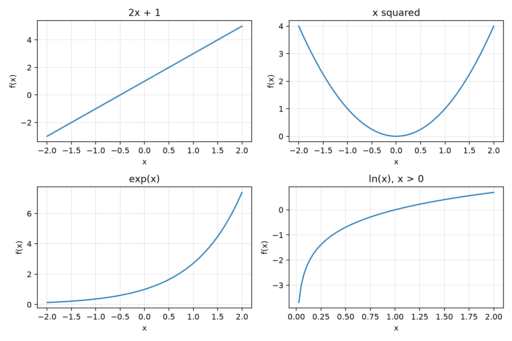

# 第 08 章　数学表达式、函数与曲线

[上一章：对象、Git 与可重复的实验记录](../07-classes-git-and-reproducibility/README.md) · [全书目录](../../README.md) · 下一章：[第09章：向量、矩阵、张量与 NumPy](../09-numpy-vectors-and-arrays/README.md)

**阅读顺序：正文 → [练习](exercises.md) → [参考答案](solutions.md)。**

## 8.1 数学是描述规律的另一种语言

前置：[第03章](../03-python-values/README.md)的运算、第05章的函数以及第07章的可复现程序。数学符号像压缩过的说明书：看着短，但每个符号都对应具体操作。本章把它们重新展开。

目标不是背很多公式，而是看见一个式子时知道输入是什么、要做什么、结果意味着什么。后面线性代数、概率和训练损失都会用到这些写法。

## 8.2 从分数与比例开始

$\frac{a}{b}$表示a除以b，要求$b\ne0$。分数可以表示一份整体中占了多少，例如3条有效记录占4条记录的$3/4=0.75=75\%$。百分号表示除以100，所以75%与0.75是同一个比例。

比例要先确认分子与分母的含义。如果3厘米除以4秒，结果有厘米/秒这个单位；如果3厘米除以4厘米，单位抵消，得到没有单位的比例。

比较两个数时，$a<b$表示a小于b，$a\le b$允许相等，$a\ne b$表示不相等。绝对值$|a|$表示它离0多远，例如$|-3|=3$，在Python中对应`abs(-3)`。

不要把单位写在公式之外就忘掉它。2米与30厘米相加前，要先转换成相同单位。以后神经网络即便接收的都是数字，也不会自动知道你混用了两套单位。

## 8.3 集合、成员与下标

**集合（set）**描述“有哪些元素”，例如$S=\{2,4,6\}$。$4\in S$表示4属于这个集合，$3\notin S$表示3不属于。数学集合不依赖排列顺序，也不重复计算同一个元素。

$\mathbb R$表示实数范围，包含我们熟悉的正负整数、分数以及许多不能写成有限小数的数。写$x\in\mathbb R$，就是说明x取实数。以后会给向量和矩阵增加维数说明。

若有三次测量2、4、6厘米，可以写$x_1=2$、$x_2=4$、$x_3=6$。下标1、2、3用来标记第几次，**不是做乘法**。数学示例常从1编号，Python列表从0编号，所以数学$x_1$在本例代码中对应`xs[0]`。

若写$x_i$，表示第i次测量；i是变化的编号，具体范围要另行说明。读公式时先找编号从哪里到哪里。

## 8.4 求和与连乘是循环的简写

把三个测量相加，可以写成：

$$
\sum_{i=1}^{3}x_i=x_1+x_2+x_3=2+4+6=12.
$$

大写希腊字母$\sum$表示求和；下方$i=1$表示起点，上方3表示终点，右侧$x_i$是每次加的内容。i只是临时编号，换成j并保持一致，不会改变结果。

对应程序是：

```python
xs = [2, 4, 6]
total = 0
for x in xs:
    total = total + x
print(total)
```

Python内置`sum(xs)`可以完成同样的求和，但手写循环能帮助你看清计算。若求平方和，式子是$\sum_i x_i^2$，代码要累计`x ** 2`。它不等于$(\sum_i x_i)^2$：本例前者是56，后者是144。

同样，$\prod_{i=1}^{3}x_i$表示连乘$2\times4\times6=48$。连乘的累计初值为1；若从0开始乘，之后永远得到0。

**算术平均数**把总和均分到数量上：

$$
\bar x=\frac{1}{n}\sum_{i=1}^{n}x_i.
$$

n是测量个数，必须大于0。本例平均值为12/3＝4厘米。与第03章平均速度相比，这里平均的是一组位置数值，含义不同；符号上方横线都用于提醒“这里做了平均”。

## 8.5 数学函数与程序函数

数学函数像一个明确的对应规则：给定允许的输入，得到确定的输出。例如：

$$
f(x)=2x+1.
$$

其中$2x$表示2乘以x；数学常省略乘号，Python必须写`2 * x`。$f(3)=2\times3+1=7$，表示把输入3交给f。

允许输入的范围称为**定义域**；实际可能得到的输出构成**值域**。例如在实数范围内，$g(x)=1/x$不能接受0，$h(x)=\sqrt{x}$要求$x\ge0$。

数学函数$f$与Python的`def f(x)`有联系，但Python函数还可能写文件或修改对象。为了对照数学，本章的计算函数只根据输入返回数值。

**复合函数**就是先算一个，再把结果交给另一个：若$g(x)=x^2$，则$f(g(3))=f(9)=19$，而$g(f(3))=g(7)=49$。顺序不同，结果可能不同，这会在后面组合网络层时再次出现。

## 8.6 用坐标和曲线看规律

平面上可以用两个数确定一个点：横向位置x、纵向位置y，记为$(x,y)$。画函数图像时，把输入放横轴，输出$y=f(x)$放纵轴。

对于$f(x)=2x+1$，取x为0、1、2，得到点(0,1)、(1,3)、(2,5)。这些点位于一条直线上。式子$y=ax+b$中，a决定x增加1时y改变多少，b是x为0时的输出。

这个a常称为直线的**斜率（slope）**。先用“横向增加多少、纵向跟着改变多少”理解它；第13章会把这种变化率推广到曲线。

画图时只给两三个点，不能证明中间没有变化。计算机绘图一般先计算一批输入位置的输出，再连接这些点。采样太稀可能漏掉细节。

## 8.7 幂、平方根与指数

对正整数n，$a^n$表示把a乘n次。例如$2^3=2\times2\times2=8$。对于非零a，$a^0=1$，$a^{-n}=1/a^n$。指数运算的基本关系是$a^{u+v}=a^u a^v$，此处先使用正底数以避免其他定义问题。

平方根$\sqrt{x}$取平方后等于x的非负数。例如$\sqrt9=3$。解方程$z^2=9$却有3和−3两个解，不能把“平方根符号的值”和“方程的全部解”混淆。

把变量放在指数上，例如$f(x)=2^x$，得到**指数函数**。x每增加1，输出乘2。相对于每次只增加固定数的直线，它增长得越来越快。

数学中经常用一个约为2.71828的常数$e$作底，写$e^x$或$\exp(x)$。本章先把它当作一类标准指数函数，后面求导时会看到它的便利。代码使用`math.exp(x)`，不是要自己输入一个截断的小数e再做幂。

## 8.8 对数：反过来问“指数是多少”

已知$2^3=8$，反过来问2的几次幂得到8，答案是3，写为$\log_2 8=3$。一般地：

$$
\log_b x=y\quad\Longleftrightarrow\quad b^y=x,
\qquad b>0,\ b\ne1,\ x>0.
$$

b是底数，x是要求对数的正数，y是结果；双向箭头表示两种说法等价。以e为底的对数称为**自然对数**，写$\ln x$。很多机器学习资料中的log默认指自然对数，但仍需查看作者约定。

因为指数中的相加对应相乘，对数把乘积变为和：

$$
\ln(ab)=\ln a+\ln b,\qquad
\ln(a/b)=\ln a-\ln b\quad(a,b>0).
$$

例如$\log_2(4\times8)=\log_2 32=5$，也等于2+3。注意$\ln(a+b)$一般不等于$\ln a+\ln b$。以后概率模型会利用“乘积转为和”来方便计算。

自然对数在$x=1$时为0，在0与1之间为负，在大于1时为正。随着x从正方向接近0，$\ln x$向负方向无限下降；在本章实数范围内，不能直接计算$\ln0$或负数的对数。

Python里`math.log(x)`是自然对数，`math.log2(x)`以2为底，`math.exp(math.log(x))`在正输入上应近似回到x。这里用“近似”是因为浮点计算仍有误差。

## 8.9 角度、弧度与圆上的位置

机器人转向要描述角度。整圈360度也可以写成$2\pi$弧度，其中$\pi$是圆周长与直径的比，约3.14159。**弧度（radian）**用圆上的弧长除以半径来量角，因此半圈是$\pi$，四分之一圈是$\pi/2$。

换算关系：角度数乘$\pi/180$得到弧度数。90度对应$\pi/2$。Python的三角函数通常接收弧度，不能把90直接当作90度传给`math.sin`。

看半径1的圆，从最右端开始沿逆时针转过角度$\theta$，圆上点的横坐标是$\cos\theta$，纵坐标是$\sin\theta$。这给出了**余弦**和**正弦**的直观定义。

| 角度 | 弧度 | cos | sin |
| --- | --- | --- | --- |
| 0度 | 0 | 1 | 0 |
| 90度 | $\pi/2$ | 0 | 1 |
| 180度 | $\pi$ | −1 | 0 |

在单位圆上，横纵坐标满足$\cos^2\theta+\sin^2\theta=1$。后面旋转矩阵会利用这些量。本章要求看懂圆上位置和单位换算，不要求背整套三角恒等式。

## 8.10 把公式变成可以查看的图

绘图采用第三方包Matplotlib。进入第02章的独立环境后，使用 `python -m pip install matplotlib` 安装。作者实际验证的版本见[检查记录](validation.md)。

[examples/formulas.py](examples/formulas.py)只用标准库，检查求和、连乘、复合函数、对数与角度。[examples/plot_functions.py](examples/plot_functions.py)生成下图：



图8-1：每幅图都以输入x为横轴、函数输出为纵轴。观察平方函数的对称性、指数的增长和对数只在正输入上取值。各图纵轴范围不同，不能只凭视觉陡峭程度比较增长速度。

绘图脚本中的 `import matplotlib.pyplot as plt` 给绘图模块起简称plt；`figure`建立画布；`subplot(2,2,编号)`选中两行两列里的一个位置；`plot(xs,ys)`按一一对应的数据点画线；`xlabel/ylabel`标注轴；`savefig`保存图片。输出目录用第06章的Path创建。

从本章目录运行：

```bash
python3 examples/formulas.py
python3 examples/plot_functions.py
```

修改一个函数，例如把直线改为$3x-1$，先预测截距和变化速度，再重新生成图。把公式、手算点与代码输出对起来，才算真正读懂。

## 8.11 过关标准

能把求和与连乘写成循环；区分平方和与和的平方；计算复合函数；说明指数与对数互为反向操作；知道正弦余弦使用的角度单位；能检查曲线的定义域。

参考：[Python math函数](https://docs.python.org/3/library/math.html)、[Matplotlib基础绘图](https://matplotlib.org/stable/tutorials/pyplot.html)，核验2026-10-24。数学解释和例题为教材自编，下一章用这些符号描述向量与矩阵。

---

[上一章：对象、Git 与可重复的实验记录](../07-classes-git-and-reproducibility/README.md) · [全书目录](../../README.md) · 下一章：[第09章：向量、矩阵、张量与 NumPy](../09-numpy-vectors-and-arrays/README.md)
