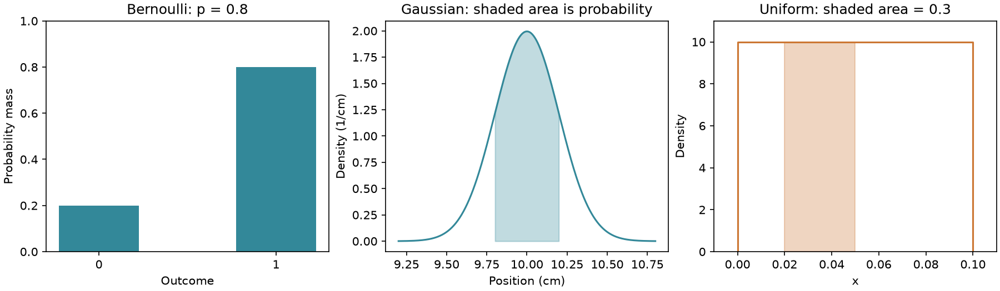

# 第 12 章　随机变量、分布、期望与抽样

[上一章：概率、条件概率与贝叶斯公式](../11-probability/README.md) · [全书目录](../../README.md) · 下一章：[第13章：导数、偏导数、链式法则与梯度](../13-calculus-and-gradients/README.md)

**阅读顺序：正文 → [练习](exercises.md) → [参考答案](solutions.md)。**

## 从事件走向带噪声的测量

上一章研究“会不会报警”。现在机器人连续测量同一方块的位置，每次读数都略有变化。我们需要描述“可能测到哪些数”“通常在什么位置”“偏离有多大”。先修是第11章条件概率与第09章数组求平均；本章在出现面积记号时会补充解释，不要求先学积分技巧。

## 1. 随机变量：给随机结果一个数字

**随机变量**像一个给试验结果贴数字标签的规则。准确地说，它是把样本空间中的结果映射成实数的函数。用大写 $X$ 表示规则，小写 $x$ 表示某个可能值或一次观测值。例如抓取成功记1、失败记0；测得位置可以记成厘米数。

**分布**就是“哪些结果可能出现，各有多大机会”的完整描述。离散变量的取值能一个个列出来，例如0、1，或者0、1、2……。它的**概率质量函数**写作 $p(x)=P(X=x)$，每个值非负，所有值相加为1。

连续变量则可以在区间内取值。用连续模型描述位置时，概率分散在无穷多个可能数上。我们用**概率密度** $f(x)$ 描述每单位长度附近聚集多少概率：小区间宽度 $\Delta x$ 足够小时，区间概率约为 $f(x)\Delta x$。

想象把一块面积为1的面团沿横轴摊开：高度是密度，一段下面的面积才是那段的概率。因此密度可以高于1。例如在 $[0,0.1]$ 上均匀分布，密度是10，但整个面积仍是 $10\times0.1=1$。

用一个新记号压缩“曲线下的面积”：

$$
P(a\le X\le b)=\int_a^b f(x)\,dx.
$$

长长的 $\int$ 是积分符号，这里只表示从 $a$ 到 $b$ 把很多小条面积累加；$dx$ 提醒我们沿 $x$ 方向累加。现在无需学习积分计算方法。对有密度的连续分布，单点宽度为0，$P(X=x)=0$，这并不表示区间里的数不会被观测到。真实传感器有有限精度，显示“1.23”通常对应一个舍入区间，不能把显示值直接当作理想连续模型的单点。

## 2. 三种常见分布

### 2.1 伯努利：只有两种结果

**伯努利分布**像一次“成功或失败”的抽签，结果 $X\in\{0,1\}$，成功概率 $p$：

$$
P(X=1)=p,\quad P(X=0)=1-p,\qquad X\sim\operatorname{Bernoulli}(p).
$$

符号 $\sim$ 在这里读作“服从这个分布”。例如 $p=0.8$ 的抓取成功模型。不能因为只看见一次成功，就断定 $p=1$。

### 2.2 类别：一次选一个类别

**类别分布**像装着不同颜色纸条的袋子，一次抽出一个类别。准确地说，对 $K$ 个互斥且完整的类别，概率 $p_1,\ldots,p_K$ 非负且和为1，$P(X=k)=p_k$。例如红、蓝、绿的概率为0.5、0.3、0.2。类别编号1、2、3是名字的编码，并不意味着绿色是红色的三倍。

### 2.3 高斯：中间常见，两边逐渐少

**高斯分布**也叫正态分布，形状像钟：中心附近最常见，离中心越远越少。它的准确密度为：

$$
f(x)=\frac{1}{\sqrt{2\pi}\sigma}\exp\left(-\frac{(x-\mu)^2}{2\sigma^2}\right),\qquad \sigma>0.
$$

$\mu$ 读作 mu，控制中心；$\sigma$ 读作 sigma，控制宽度；$\pi$ 是圆周率，$\exp$ 是第08章的指数函数。前面的系数保证面积为1。常记 $X\sim\mathcal N(\mu,\sigma^2)$，第二个参数写方差；但 NumPy `rng.normal(loc=mu, scale=sigma, size=n)` 的 `scale` 接收标准差，别把平方后的数传进去。[NumPy normal 文档](https://numpy.org/doc/stable/reference/random/generated/numpy.random.Generator.normal.html)

带噪声测量可以设成 $X=10+\varepsilon$，其中 $\varepsilon\sim\mathcal N(0,0.2^2)$，单位都是厘米。这是一个可用来学习的模型，不是所有误差必定高斯：偶发错误匹配可能产生很远的离群值，机械误差也可能持续偏向同一侧。



图中左侧柱高直接表示0和1的概率；中间和右侧曲线的高度表示密度，阴影面积才表示对应区间的概率。右侧密度高达10，但阴影面积只有0.3。图由本章 `examples/plot_distributions.py` 生成，图内使用英文标签以便在不同系统显示。

## 3. 期望：用机会作权重的平均

**期望**像把许多次结果堆起来后的平衡点。准确地说，对离散变量：

$$
\mathbb E[X]=\sum_x xP(X=x).
$$

$\mathbb E$ 是期望符号，求和遍历所有可能值。例如公平骰子期望 $(1+2+3+4+5+6)/6=3.5$；一次骰子不可能掷出3.5，期望不一定是可能观测值。

对某个函数 $g$，$\mathbb E[g(X)]=\sum_x g(x)P(X=x)$。连续情况把“求和”换成密度加权的面积累加 $\int g(x)f(x)dx$；要求这个期望确实存在。

期望有一个很有用的规则：$\mathbb E[aX+bY]=a\mathbb E[X]+b\mathbb E[Y]$，不要求 $X,Y$ 独立。例如每次测量都额外加2厘米，平均值也加2厘米。注意一般 $\mathbb E[X^2]\ne(\mathbb E[X])^2$。

## 4. 方差：结果散得有多开

两个传感器的平均读数都为10，一个总在9.9到10.1附近，另一个经常跳到8或12，仅看均值无法区分。**方差**就是偏离均值的平方的平均：

$$
\operatorname{Var}(X)=\mathbb E[(X-\mu)^2]=\mathbb E[X^2]-\mu^2,\quad\mu=\mathbb E[X].
$$

最后一个等式来自展开 $(X-\mu)^2=X^2-2\mu X+\mu^2$ 并取期望。平方避免正负偏差互相抵消。**标准差**是方差的平方根，和原变量单位相同：厘米的方差单位是平方厘米，标准差是厘米。

伯努利变量满足 $X^2=X$，所以均值为 $p$，方差为 $p-p^2=p(1-p)$。当 $p=0$ 或1时结果确定，方差0；当 $p=0.5$ 时最难猜。

平移不改变方差，放大则按平方改变：$\operatorname{Var}(aX+b)=a^2\operatorname{Var}(X)$。均值接近真实值与方差小是两回事：一个传感器可以很稳定地报错位置。

## 5. 总体与样本：手里的数据不是全部世界

**总体**是我们想研究的全部对象或数据生成分布；**样本**是实际拿到的一小部分观测。对 $n$ 个观测 $x_1,\ldots,x_n$，样本均值为：

$$
\bar x=\frac1n\sum_{i=1}^n x_i.
$$

它估计总体均值，但不自动等于真值。描述手里这组数自身的离散程度时，可用 $v_n=\frac1n\sum_i(x_i-\bar x)^2$。如果想在独立同分布抽样假设下无偏估计总体方差，常用：

$$
s^2=\frac1{n-1}\sum_{i=1}^n(x_i-\bar x)^2,\quad n>1.
$$

**独立同分布**可以理解为每次用同一规则抽签、各次不互相影响；准确地说，样本相互独立且服从同一分布。**无偏**表示重复抽样以后估计量的期望等于目标，不能保证每一次都准确。为什么是 $n-1$？因为均值也用这批样本估计，偏差之和被限制为0，平方偏差和的期望为 $(n-1)\sigma^2$，除以 $n-1$ 才补偿这个平均缩小效应。

对于数据 $[1,2,3]$，均值2，平方偏差和2，除以3得 $2/3$，除以2得1。NumPy `np.var(x)` 默认除以 $n$；`np.var(x, ddof=1)` 除以 $n-1$。应明确你要描述样本还是估计总体，不能认为两个结果不同就是工具错误。[NumPy var 文档](https://numpy.org/doc/stable/reference/generated/numpy.var.html)

## 6. 两个量会不会一起变

**协方差**像观察两个人是否经常一起向同一边走。准确地说：

$$
\operatorname{Cov}(X,Y)=\mathbb E[(X-\mathbb E[X])(Y-\mathbb E[Y])].
$$

同高同低时乘积多为正，协方差倾向为正；一个高另一个低时倾向为负。对二维位置 $(X,Y)$，**协方差矩阵**把各轴的方差和轴间协方差排成表：

$$
\Sigma=\begin{bmatrix}\operatorname{Var}(X)&\operatorname{Cov}(X,Y)\\\operatorname{Cov}(Y,X)&\operatorname{Var}(Y)\end{bmatrix}.
$$

它描述误差在各个方向怎样散开。两个量的单位会影响协方差大小；除以各自标准差得到无量纲的相关系数，前提是两者标准差非零。独立且相关期望存在时协方差为0，但协方差为0不保证独立：若 $X$ 在 $-1,0,1$ 上等概率，令 $Y=X^2$，两者协方差0，$Y$ 却被 $X$ 完全决定。

**标准化**是先移到中心再换一把尺子：$z=(x-\mu)/\sigma$。若用样本均值和 `ddof=0` 标准差处理同一批非恒定数据，其处理后均值约0、方差约1。标准化不把任意分布变成高斯分布，也不能对标准差0的列直接做除法。未来训练时要用训练数据估计这些量，再固定用于其他数据。

## 7. Monte Carlo：用重复抽样估计平均结果

Monte Carlo（蒙特卡洛）方法可以理解为“答案难直接算，就按规则多试几次再取平均”。对独立同分布样本：

$$
\mathbb E[g(X)]\approx\frac1n\sum_{i=1}^{n}g(x_i).
$$

如果 $g(X)$ 有有限方差 $\sigma_g^2$，这个均值估计的方差为 $\sigma_g^2/n$，标准差为 $\sigma_g/\sqrt n$。这叫均值的标准误差，描述多次重新采样时估计结果怎样变化。样本量扩大4倍，典型误差尺度约减半，不是缩小4倍。

连续视频帧往往高度相关，不能直接把每一帧都当成一次独立抽样来套公式；重复复制同一条数据也不会增加真实信息。固定种子方便复现一次实验，却不能替代多次独立实验。

运行：

```bash
python chapters/12-distributions-and-statistics/examples/statistics_demo.py
```

脚本先核对可手算的数据，再模拟位置测量，并对每个样本量重复400次，比较“均值在不同实验中的波动”。一次小样本恰好更准并不推翻统计规律，应比较多次实验的整体分布。

代码中 `.astype(float)` 把真假变成1.0和0.0；`rng.choice(..., p=...)` 按给定概率抽取类别。最后的 `{name: ... for name in ...}` 是字典推导式：对每个名称计算一个频率，再把名称和频率配成字典。它等价于先创建空字典，再在 `for` 循环中逐个赋值。

## 过关标准

你能区分概率、密度、样本频率；能手算三个数的均值和两种方差；能解释标准差与标准误差；知道采样结论依赖数据如何产生。这些概念将用于后面的训练噪声、模型不确定性和评测。

---

[上一章：概率、条件概率与贝叶斯公式](../11-probability/README.md) · [全书目录](../../README.md) · 下一章：[第13章：导数、偏导数、链式法则与梯度](../13-calculus-and-gradients/README.md)
