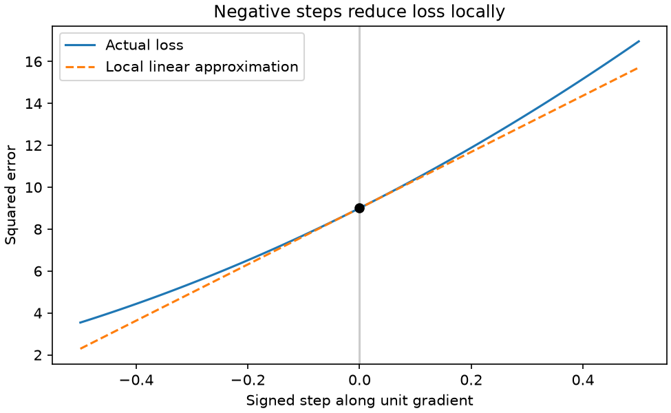

# 第 13 章　导数、偏导数、链式法则与梯度

[上一章：随机变量、分布、期望与抽样](../12-distributions-and-statistics/README.md) · [全书目录](../../README.md) · 下一章：[第14章：从误差到梯度下降](../14-optimization/README.md)

**阅读顺序：正文 → [练习](exercises.md) → [参考答案](solutions.md)。**

## 这一章解决什么问题

第08章讲函数，第10章讲向量和变换。现在我们想知道：如果轻轻转动一个参数旋钮，结果会往哪边变、变多少？这正是以后调整模型参数需要的信息。先修检查：能展开 $(x+h)^2$，知道函数复合的先后，能算两个向量的点积。

## 1. 从平均变化率走向瞬时变化率

小车的位置为 $s(t)=t^2$，时间单位秒，位置单位米。从 $t=2$ 到 $t=3$，平均速度是 $(9-4)/(3-2)=5$米/秒。但在恰好2秒那一刻，速度是多少？

把时间间隔换成较小的 $h\ne0$：

$$
\frac{s(2+h)-s(2)}h=\frac{(2+h)^2-4}h=4+h.
$$

$h=0.1$ 时得到4.1，$h=0.01$ 时得到4.01；从负方向靠近也趋向4。**极限**可以先理解为“越靠近某处，结果越靠近哪个稳定数”；准确地说，当输入足够接近目标时，函数值能任意接近该数。这里不把 $h=0$ 直接代入除法，而研究 $h$ 趋近0的行为。

**导数**是这一瞬间的变化率，也是在曲线上紧贴该点的一条直线的斜率。对函数 $f$，定义：

$$
f'(x)=\lim_{h\to0}\frac{f(x+h)-f(x)}h.
$$

$f'$ 读作“f的导数”，也写 $df/dx$。这个符号整体表示对 $x$ 求导，初学时不要把它当普通分数随意约掉。极限存在才说函数在该点可导。

对任意 $x$，$f(x)=x^2$ 的差商为 $2x+h$，故 $f'(x)=2x$。导数描述局部变化，并不表示函数在所有地方都是这条直线。

## 2. 局部线性近似

当改变量 $\Delta x$ 很小时：

$$
f(x+\Delta x)\approx f(x)+f'(x)\Delta x.
$$

$\Delta$ 表示变化量，$\approx$ 表示近似相等。以 $x=2,\Delta x=0.01$ 为例，预测 $f(2.01)\approx4+4\times0.01=4.04$，实际4.0401，差0.0001。遗漏项正好是 $(\Delta x)^2$。

这里藏着训练的思路：若导数为正，向左挪一点通常让函数变小；若为负，向右挪一点通常让函数变小。但步子太大，局部直线就可能预测不准。

## 3. 几条常用求导规则

规则能省去每次重新展开极限，但先理解它们是在计算变化率。以下等式在相应函数可导、表达式有定义的地方成立，$c$ 为常数：

| 函数 | 导数 | 直观解释或条件 |
|---|---|---|
| $c$ | 0 | 输入变，输出不动 |
| $x$ | 1 | 输入多1，输出多1 |
| $x^n$ | $nx^{n-1}$ | 这里先取正整数 $n$ |
| $cf(x)+g(x)$ | $cf'(x)+g'(x)$ | 变化率同样能相加、缩放 |
| $f(x)g(x)$ | $f'(x)g(x)+f(x)g'(x)$ | 两个因素都可能变化 |
| $\exp x$ | $\exp x$ | 指数的增长率等于自身 |
| $\ln x$ | $1/x$ | 只在 $x>0$ 使用 |
| $\sin x$ | $\cos x$ | 角度采用弧度 |
| $\cos x$ | $-\sin x$ | 角度采用弧度 |

乘积规则为什么有两项？两个因素分别变为 $f+\Delta f$、$g+\Delta g$，乘积改变量为 $g\Delta f+f\Delta g+\Delta f\Delta g$。最后一项对小变化是更高阶的小量，于是变化率主要由前两项构成。不能把乘积的导数写成导数的乘积。

尖角处可能没有唯一斜率。例如 $f(x)=|x|$，$x>0$ 导数1，$x<0$ 导数−1，0处左右不一致所以不可导。以后某些神经网络函数在尖角处采用约定的梯度值，那是计算规则，不能倒过来说经典导数在该点存在。

## 4. 链式法则：变化沿着中间步骤传过去

想象两个齿轮：第一个把输入变化放大3倍，第二个在当前状态把变化放大10倍，最后约放大30倍。**链式法则**准确地说，是复合函数的导数等于沿计算路径各层局部导数的乘积：

$$
y=g(u),\quad u=f(x),\qquad \frac{dy}{dx}=g'(u)f'(x).
$$

例如 $y=(3x+1)^2$。先设 $u=3x+1$，再算 $y=u^2$：$du/dx=3$，$dy/du=2u$，所以 $dy/dx=2(3x+1)\times3$。在 $x=2$ 时，$u=7$，导数42。

另一例 $y=\ln(1+x^2)$：内部 $u=1+x^2$ 的导数 $2x$，外部 $\ln u$ 的导数 $1/u$，相乘得到 $2x/(1+x^2)$。每次都先写中间变量，避免漏掉内层的导数。

## 5. 多个旋钮：偏导数与梯度

一个预测器用 $\hat y=wx+b$，其中 $x$ 是固定输入，$w,b$ 是可调参数，$\hat y$ 读作“预测的 y”。若真实目标为 $y$，定义平方误差：

$$
L(w,b)=(wx+b-y)^2.
$$

**偏导数**像只拧一个旋钮，其他旋钮暂时固定。准确地说，是多元函数对某一输入坐标求导，其余坐标保持不变。符号 $\partial$ 用于提示这种“偏着看一项”的求导：

$$
\frac{\partial L}{\partial w}=2(wx+b-y)x,
\qquad
\frac{\partial L}{\partial b}=2(wx+b-y).
$$

推导仍是链式法则。设残差 $r=wx+b-y$，外层 $r^2$ 导数 $2r$；对 $w$，$\partial r/\partial w=x$；对 $b$，$\partial r/\partial b=1$。

**梯度**像把每个旋钮的影响分别记在一张表上。准确地说，标量函数对所有输入坐标的偏导数组成一个向量：

$$
\nabla L=\begin{bmatrix}\partial L/\partial w\\\partial L/\partial b\end{bmatrix}.
$$

$\nabla$ 读作 nabla。若 $x=2,y=5,w=1,b=0$，预测2，残差−3，误差9，梯度为 $(-12,-6)$。负号告诉我们，在附近增加 $w$ 或 $b$ 都有助于减少误差；影响大小还与各参数单位有关。

## 6. 为什么沿负梯度走通常会下降

把所有参数排成向量 $\theta$，小改变量记为 $\Delta\theta$。多元局部线性近似为：

$$
L(\theta+\Delta\theta)\approx L(\theta)+\nabla L(\theta)^\top\Delta\theta.
$$

**方向导数**表示沿指定方向走一点时的变化率；对可微函数和单位方向 $u$，它等于 $\nabla L^\top u$。根据第10章点积与夹角的关系，单位步长下与梯度反向时，点积最小。这就是欧几里得长度衡量下负梯度最陡下降的局部解释。

设 $\Delta\theta=-\eta\nabla L$，其中 $\eta>0$ 是小步长：

$$
\Delta L\approx-\eta\|\nabla L\|_2^2\le0.
$$

近似要求步长足够小，不能当作任何大步长都下降的保证。用上面的例子取 $\eta=0.01$，新参数 $w=1.12,b=0.06$，预测2.30，误差7.29，确实比9小。线性近似给出 $9-0.01(144+36)=7.2$，与真实7.29略有差别。



图的横轴是有符号步长 $\alpha$，参数按 $\theta+\alpha u$ 改变，其中 $u$ 是单位梯度方向。0附近向右误差增加、向左误差减小；虚线只给出局部近似。本图由本章脚本生成。

## 7. 多个输出：Jacobian 是一张导数表

**Jacobian（雅可比矩阵）**像一张表：每行一个输出，每列一个输入，格子里写“这个输入改变，会影响这个输出多少”。准确地说，对 $f:\mathbb R^n\to\mathbb R^m$：

$$
J_{ij}=\frac{\partial f_i}{\partial x_j},\qquad J\in\mathbb R^{m\times n}.
$$

例如 $f(x_1,x_2)=(x_1^2+x_2,\ 3x_1-x_2)$，则：

$$
J=\begin{bmatrix}2x_1&1\\3&-1\end{bmatrix}.
$$

在 $x_1=2$ 时，输入变化 $(0.01,0)$，输出变化约为 $(0.04,0.03)$。梯度专用于一个标量输出，通常写成列向量；此时 Jacobian 是一行，等于梯度的转置。未来机器人末端位置有多个坐标，所以会用 Jacobian 表示关节变化如何影响位置。

## 8. 有限差分：用小试探检查公式

**有限差分**就是实际让输入往两边各挪一点，用输出差估计斜率。中心差分写成：

$$
f'(x)\approx\frac{f(x+h)-f(x-h)}{2h}.
$$

对多元参数，第 $i$ 项使用 $(L(\theta+he_i)-L(\theta-he_i))/(2h)$，$e_i$ 是第 $i$ 个位置为1、其余为0的向量。代码中复制参数数组再改一项，以免各次试探相互污染。

为什么不把 $h$ 取得无限小？过大时函数弯曲导致近似误差；过小时两个相近浮点数相减丢失有效数字，舍入误差反而变明显。检查梯度时通常尝试几个尺度，同时避开不可导点。有限差分需要多次计算函数，适合小例子排错，不适合给上亿参数逐个试探。

```bash
python chapters/13-calculus-and-gradients/examples/gradients.py
python chapters/13-calculus-and-gradients/examples/plot_gradient.py
```

前者比较手算和数值梯度，后者生成图。图形脚本需要前面已安装的 Matplotlib；无窗口环境可设置 `MPLBACKEND=Agg`。有限差分原理与微积分基础可补充阅读 [D2L 微积分](https://d2l.ai/chapter_preliminaries/calculus.html)。

## 过关标准

能从差商推导 $x^2$ 的导数；能分步求复合函数导数；能手算二参数平方误差梯度；能区分标量输出梯度和多输出 Jacobian；能解释有限差分为什么既有用又不精确。下一章把一次小调整重复很多次，形成优化算法。

---

[上一章：随机变量、分布、期望与抽样](../12-distributions-and-statistics/README.md) · [全书目录](../../README.md) · 下一章：[第14章：从误差到梯度下降](../14-optimization/README.md)
