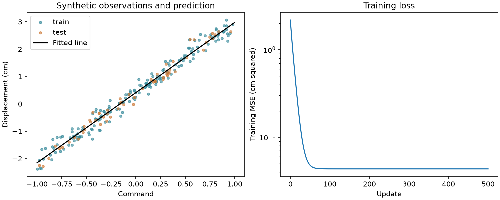

# 第 15 章　第一个机器学习问题：线性回归

[上一章：从误差到梯度下降](../14-optimization/README.md) · [全书目录](../../README.md) · 下一章：[第16章：分类、似然与交叉熵](../16-classification-and-information/README.md)

**阅读顺序：正文 → [练习](exercises.md) → [参考答案](solutions.md)。**

## 你已经具备了哪些零件

到这里，你会用 Python 读文件，会用 NumPy 表示数据，会算均值、平方误差和梯度，也会反复更新参数。现在把它们装到一起：根据一段电机指令的数值，预测方块会移动多远。本章数据由代码合成，既不连接真实电机，也不把拟合结果当作真实机器人的控制器。

**机器学习**可以先理解为让程序通过例子调整规则。更准确地说，它利用数据改进某类任务上的表现。本章采用**监督学习**：训练例子同时包含输入和希望预测的答案。**回归**任务预测一个数值，例如位移；下一章的分类任务则预测类别。

## 1. 先给数据与模型中的量分工

一次记录称为一个**样本**。程序可以在预测时获得的信息称为**特征**，这里是归一到 $[-1,1]$ 的指令数值 $x$，无量纲。训练时作为答案的测量值称为**标签**，这里是位移 $y$，单位厘米。

我们选一个简单模型：

$$
\hat y=wx+b.
$$

$\hat y$ 是预测位移，$w$ 和 $b$ 是要从数据中学习的参数。$w$ 的单位是“厘米/单位指令”，$b$ 的单位是厘米。$b$ 又称截距或偏置，表示指令为0时的模型预测。数学上它是仿射函数，习惯上仍叫线性回归。

请区分三个层次：数据 $(x_i,y_i)$、模型形式 $wx+b$、这一次训练得到的具体参数。换一批数据可以得到新的参数，不一定要换模型形式。

生成实验数据时，我们设定：

$$
y_i=2.5x_i+0.4+\varepsilon_i,\qquad
\varepsilon_i\sim\mathcal N(0,0.2^2).
$$

真实关系和噪声规则是为了教学而设定的。训练代码只读取CSV里的输入与测量，不拿生成时的真实参数做更新。由于存在噪声，拟合后的参数不必恰好等于2.5和0.4。

## 2. 先分数据，再开始训练

如果学生做完练习，又拿完全相同的题考试，分数无法充分说明是否学会新题。**训练集**用于更新参数，**测试集**保留到方案固定后估计对新样本的表现。**泛化**就是学到的规则能否适用于未参与训练的数据。

本章先用固定种子打乱240条独立合成样本，再分成180条训练、60条测试。打乱只改变顺序，不改变数据数值。保留原始行编号，确保两组没有重复。

```python
order = rng.permutation(len(data))
train_ids = order[:180]
test_ids = order[180:]
```

`permutation` 生成不重复的随机排列。这里样本按同一规则独立生成，随机拆分合理。如果是同一段视频的连续帧，或同一机器人的重复轨迹，就要按场景、设备、时间或轨迹分组；第17章会完整讲解。

本章提前固定学习率0.1和500步训练预算，只在训练完成后评测测试集一次。如果你根据测试分数反复调设置，测试集就被间接用于训练决策。需要调参时应另设验证集，而不是把同一测试分数反复当作新证据。

## 3. 先做一个简单到不能再简单的基线

**基线**像比赛前先立的一条起跑标准，用最简单的可行办法判断新方法是否有价值。本章基线完全忽略输入，总是预测训练标签均值 $c=\bar y_{\mathrm{train}}$。

为什么是均值？对于常数预测的平方误差：

$$
L(c)=\frac1N\sum_i(c-y_i)^2,\quad
L'(c)=\frac2N\sum_i(c-y_i)=2(c-\bar y).
$$

令导数为0得到 $c=\bar y$；平方和的形状是碗，因此这是最小点。必须从训练集算这个均值，不能提前用测试标签来制造更好的基线。

如果线性模型连常数基线都比不过，先查数据和代码，再考虑增加模型复杂度。

## 4. 均方误差把很多样本合成一个目标

**均方误差**（Mean Squared Error，MSE）就是每个预测先算偏差、平方，再取平均：

$$
L(w,b)=\frac1N\sum_{i=1}^{N}(wx_i+b-y_i)^2.
$$

$N$ 是当前参与计算的样本数。平方让正负误差不互相抵消，也让较大的误差受到更重惩罚。若位移单位是厘米，MSE单位就是平方厘米；开平方得到**均方根误差**（Root Mean Squared Error，RMSE），单位恢复为厘米，更方便理解。

还可以算**平均绝对误差**（Mean Absolute Error，MAE）：$\frac1N\sum_i|\hat y_i-y_i|$。本章训练用MSE，报告同时给出MSE、RMSE、MAE。不同指标强调的行为不同，不能只挑最好看的一个。

手算例子：输入 $x=(0,1)$，标签 $y=(1,3)$，初始 $w=b=0$。预测 $(0,0)$，误差 $(-1,-3)$，MSE为 $(1+9)/2=5$。

## 5. 把上一章的求导规则逐项用上

先记 $r_i=wx_i+b-y_i$。第13章已经推过单样本平方误差，现在用“和的导数等于导数的和”：

$$
\frac{\partial L}{\partial w}=\frac2N\sum_i r_i x_i,
\qquad
\frac{\partial L}{\partial b}=\frac2N\sum_i r_i.
$$

对应代码：

```python
prediction = w * x_train + b
residual = prediction - y_train
grad_w = 2 * np.mean(residual * x_train)
grad_b = 2 * np.mean(residual)
w = w - learning_rate * grad_w
b = b - learning_rate * grad_b
```

先用同一组旧参数算出两个梯度，再更新两个参数。不要先改变 $w$，又用改变后的预测去计算 $b$ 的梯度，而误以为仍在执行同一次标准梯度下降。

手算例子的梯度为 $\partial L/\partial w=-3$、$\partial L/\partial b=-4$。若学习率0.1，新参数 $w=0.3,b=0.4$，预测 $(0.4,0.7)$，新MSE为 $(0.36+5.29)/2=2.825$。

所有一维数组都采用 `(N,)` 形状。若标签误写成 `(N,1)`，它与预测 `(N,)` 相减会广播成 `(N,N)`；脚本显式检查形状相同，避免这种“能运行但算错”的情况。

## 6. 从一个特征到多个特征

如果还有物体质量、表面类型等数值特征，每个样本可用 $d$ 维向量表示。把样本按行排列成 $X\in\mathbb R^{N\times d}$，参数 $w\in\mathbb R^d$，标签 $y\in\mathbb R^N$：

$$
\hat y=Xw+b\mathbf1,\qquad
\nabla_w L=\frac2N X^\top(Xw+b\mathbf1-y).
$$

$\mathbf1$ 是 $N$ 个1组成的向量。形状核对：$X^\top$ 是 $d\times N$，残差有 $N$ 个分量，乘积是 $d$ 维，正好对应每个权重的梯度。你暂时不必扩展项目，但应看出它与一个特征的公式完全一致。

这也连接第10章最小二乘。如果把全1列接到 $X$ 旁边，记成 $A$，把 $b$ 接到参数最后，就变成求 $A\theta\approx y$。用 `lstsq` 可以得到同一个训练目标的参考解。我们用它检查手写训练是否到达合理位置，不用它替代本章的梯度推导。[D2L 线性回归](https://d2l.ai/chapter_linear-regression/linear-regression.html)

## 7. 跑通数据、训练、评测与保存

在教材根目录运行：

```bash
python chapters/15-regression-workflow/examples/generate_data.py
python chapters/15-regression-workflow/examples/train.py
```

第一步在本章 `examples/output/` 生成CSV，第二步读取并训练。输出目录被Git忽略，避免把可再生成的结果误当源码。示例把训练日志和模型结果写为CSV/JSON，代码、种子和运行命令足以重新生成。

`np.loadtxt(..., delimiter=",", skiprows=1)` 用于读取本章纯数值CSV，跳过首行列名；它不是任意脏数据清理器。第06章所讲的缺失值和字段检查仍然适用。[NumPy loadtxt 文档](https://numpy.org/doc/stable/reference/generated/numpy.loadtxt.html)

脚本会保存数据种子2026、划分种子7、样本数、学习率、步数、参数、基线和模型的测试指标。所有计算在CPU上使用NumPy，数据完全本地生成，不需下载数据或使用GPU。

**训练曲线**就是横轴放更新次数、纵轴放损失，看训练怎么变化。训练曲线下降只能说明在训练目标上有进展；它无法单独证明泛化。本章同时把数据点与拟合直线画出来，避免只盯一个数字。

训练后运行 `python chapters/15-regression-workflow/examples/plot_results.py` 可重新生成下图。右侧纵轴采用对数刻度，让较小误差的变化也可见；它仍表示MSE，不是另一种损失。



图中每个点是一条合成记录，颜色区分训练集与测试集；直线仅由训练集拟合。当前记录的参数为 $w\approx2.56384,b\approx0.41052$。测试MSE：常数基线约1.79265平方厘米，线性模型约0.03227平方厘米；模型RMSE约0.17964厘米。运行环境与范围见[检查记录](validation.md)。

## 8. 结果该怎么解释

当模型学得合理时，参数应靠近生成关系，测试误差应明显低于常数基线。噪声标准差0.2意味着即便已知精确关系，预测条件均值时的期望MSE也为 $0.2^2=0.04$；这是本教学数据模型的结论。有限测试集的MSE可以高于或低于0.04，不能把这个值当每次必须达到的分数。

也不要把“预测准确”解释为“知道因果关系”。本章输入由生成程序安排，在真实数据里指令和其他因素可能一起变化。模型还可能在 $[-1,1]$ 内拟合很好，却在远超这个范围的输入上失败，这叫**外推**：把学到的关系用于训练数据覆盖之外。

## 过关标准

你能讲清输入、标签、参数、损失各是什么；能推导并写出两项梯度；能在训练前拆分数据并设置基线；能复算报告中的MSE与RMSE；能说清结果适用的输入范围和数据来源。完成练习后，再进入“预测类别”的问题。

---

[上一章：从误差到梯度下降](../14-optimization/README.md) · [全书目录](../../README.md) · 下一章：[第16章：分类、似然与交叉熵](../16-classification-and-information/README.md)
