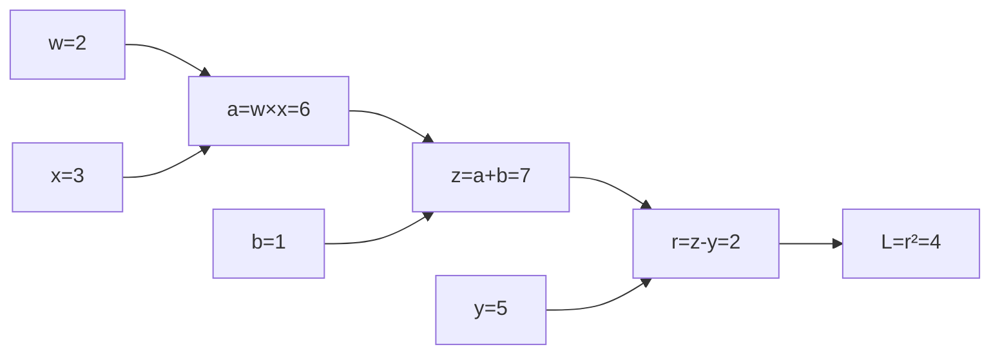

# 第 19 章　反向传播与自动求导

[上一章：神经网络如何做一次预测](../18-neural-network-forward/README.md) · [全书目录](../../README.md) · 下一章：[第20章：使用 PyTorch 训练神经网络](../20-pytorch-training/README.md)

**阅读顺序：正文 → [练习](exercises.md) → [参考答案](solutions.md)。**

## 把链式法则交给程序管理

你已经能对一条短公式手算导数，也知道网络前向计算的每一步。网络变大以后，难点不是出现了另一种微积分，而是如何不漏掉成千上万条计算路径。

**自动求导**可以先理解为让程序一边算答案，一边记住“答案是怎么来的”，然后按链式法则算导数。准确地说，它对程序执行的基础运算应用已知局部导数并组合结果。它不同于反复改输入的有限差分，也不同于把整个公式化简成符号表达式的符号求导。

本章先修：第07章类与对象、第13章链式法则、第18章前向计算。新出现的递归和图遍历会就地解释。

## 1. 计算图把中间步骤显式画出来

**计算图**像一份装配说明：圆点或方框是中间数值，箭头表示谁依赖谁。准确地说，是以变量或运算结果为节点、依赖关系为边的图。考虑：

$$
a=wx,\quad z=a+b,\quad r=z-y,\quad L=r^2.
$$

取 $w=2,x=3,b=1,y=5$，前向得到 $a=6,z=7,r=2,L=4$。



**局部导数**只看当前这一步输入输出，例如 $\partial z/\partial a=1$，$\partial a/\partial w=x=3$。我们最终想知道的是损失对最早参数的导数，而不是停在局部变化率。

## 2. 从最终损失往回传

**反向传播**就是按依赖关系从后往前，把“这一点会怎样影响最终损失”传回去。先设 $\partial L/\partial L=1$，因为损失增加一点，对自身的变化率是1。

1. $L=r^2$，得到 $\partial L/\partial r=2r=4$。
2. $r=z-y$，得到 $\partial L/\partial z=4\times1=4$；对 $y$ 是−4。
3. $z=a+b$，得到 $\partial L/\partial a=4$、$\partial L/\partial b=4$。
4. $a=wx$，得到 $\partial L/\partial w=4x=12$、$\partial L/\partial x=4w=8$。

标签 $y$ 和输入 $x$ 数学上也可以求导，但训练时通常只更新指定参数 $w,b$。能算梯度不代表每个数都应该被优化器修改。

反向传播只负责计算梯度；把参数减去学习率乘梯度是优化器的工作。二者不要混成一个动作。

## 3. 一条变量走了两条路，贡献必须相加

取 $L=x^2+x$。$x$ 既通过平方项，也直接通过加法影响损失，所以：

$$
\frac{dL}{dx}=2x+1.
$$

在 $x=3$ 时梯度7。如果程序把第二条路径的结果覆盖第一条，就可能只剩1或6。**梯度累积**在这里是把同一变量从不同依赖路径收到的贡献相加。

更微妙的是 $a=x\times x$：同一个节点作为乘法的两个输入。乘法对左输入的局部导数是右值 $x$，对右输入是左值 $x$，两份都必须保留，因此得到 $2x$。不能因为两个输入是同一个对象，就去掉一条导数贡献。

一般地，若节点 $u$ 被多个后续节点 $v$ 使用：

$$
\frac{\partial L}{\partial u}=\sum_{v}\frac{\partial L}{\partial v}\frac{\partial v}{\partial u}.
$$

求和遍历所有直接使用 $u$ 的路径贡献。把 `+=` 错写成 `=` 是最常见的教学错误之一。

## 4. 反向顺序为什么不能随便排

想拆一台积木机器，应先拆最外层，再拆里面。计算图也需要遵守依赖顺序。**拓扑顺序**指每个节点都排在所有依赖它的后续节点之前；前向沿这个顺序，反向则倒着走。

本章图没有沿箭头转一圈回到自身的环，这类图叫**有向无环图**。即使模型在时间上反复计算，某次实际展开的每一步也可以形成这样的图。

示例通过一个递归函数先访问父节点，再把当前节点放进列表。**递归**是函数调用自己来处理更小的问题；这里更小的问题是“先处理这个节点的父节点”。用 `seen` 集合记录已访问节点，避免共享子图被重复展开。遍历中的去重只针对“节点处理一次”，不删除乘法里的两条导数边。

从末端倒序处理时，一个节点的所有后续贡献已经汇总完毕，才能正确继续传向它的父节点。

## 5. 最小标量求导器保存哪些东西

本章 `scalar_autodiff.py` 中，每个 `Node` 保存：

- `value`：本次前向算出来的标量值。
- `grad`：最终损失对该节点的导数，初始0。
- `parents`：父节点及本次前向位置的局部导数。

为了让代码更容易读，我们用 `add(a,b)`、`multiply(a,b)`、`relu(a)` 这样的函数，不要求先理解Python运算符重载。`parents` 是列表，允许同一父节点出现两次。反向时对每条边执行 `parent.grad += node.grad * local_derivative`。

这份最小实现每次调用 `backward()`，会把本图所有可达节点梯度清零，再计算一次。因此同一张图重复调用得到相同梯度。这是本书的简化约定，**不同于PyTorch默认把叶子参数梯度累加的行为**；下一章会要求训练循环显式清零。

本实现只有标量运算，无GPU、无张量广播、无高阶求导，也不能在前向后任意修改节点值再复用旧图。更新参数后应重新前向，重新记录正确的局部导数。

## 6. 矩阵层的反向公式

逐个标量追踪有助于理解，真实网络用矩阵批量计算更高效。对一层：

$$
Z=XW+b,\quad X\in\mathbb R^{B\times d},\ W\in\mathbb R^{d\times h}.
$$

假设从后面传来的梯度 $G=\partial L/\partial Z$ 形状为 $B\times h$，则：

$$
\frac{\partial L}{\partial W}=X^\top G,\quad
\frac{\partial L}{\partial b}=\sum_{i=1}^{B}G_i,\quad
\frac{\partial L}{\partial X}=GW^\top.
$$

为什么权重梯度要求和？同一个权重被每个样本共用，所有样本的贡献都应相加。偏置也被每行共用，所以沿批量轴求和。如果 $G$ 中已经包含平均损失的 $1/B$，这里不要再除一次，否则梯度会无故变小。

对 $H=\operatorname{ReLU}(A)$，传来的梯度为 $G_H$，则 $G_A=G_H\odot\mathbf1_{A>0}$。$\odot$ 表示逐元素乘法，$\mathbf1_{A>0}$ 是正数位置为1、其余为0的数组；0处采用梯度0约定。

现在对两层回归网络完整写一遍：

$$
A=XW_1+b_1,\ H=\operatorname{ReLU}(A),\ Z=HW_2+b_2,
\quad L=\frac1B\sum_i(Z_i-y_i)^2.
$$

先得到 $G_Z=2(Z-y)/B$，再依次计算 $\nabla W_2=H^\top G_Z$、$\nabla b_2=\sum_iG_{Z,i}$、$G_H=G_ZW_2^\top$、$G_A=G_H\odot\mathbf1_{A>0}$，最后 $\nabla W_1=X^\top G_A$、$\nabla b_1=\sum_iG_{A,i}$。全程使用本次前向的旧参数；完成所有梯度后才更新。

## 7. 用有限差分发现漏项

```bash
python chapters/19-backpropagation/examples/scalar_autodiff.py
python chapters/19-backpropagation/examples/check_matrix_backward.py
```

第一个脚本核对 $x^2+x$ 在3处梯度7，以及前面的单样本模型梯度12和4。第二个脚本对一个2→3→1网络的每个参数做中心差分，再和矩阵反向公式比较。

检查时选择远离ReLU尖角的参数和输入，使用浮点64位与适当差分步长。数值近似有误差，比较应使用小容差，不能要求浮点逐位一致。如果故意漏掉偏置的求和、把某条路径覆盖、重复除以批量大小，数值检查通常能发现。

有限差分只能核对所选输入附近，不是所有程序的正确性证明。先手算小例子，再检查一批不同位置，比只跑一次大训练等待报错更容易定位问题。[D2L 反向传播](https://d2l.ai/chapter_multilayer-perceptrons/backprop.html)

## 8. 经典GitHub项目：micrograd

现在你已经到达适合阅读 [karpathy/micrograd](https://github.com/karpathy/micrograd) 的位置。它是一个小型标量自动求导引擎，加上简洁的神经网络代码，适合理解链式法则怎样变成程序。它不是面向大图像或GPU批量训练的工具。

建议按以下顺序选读：

1. [micrograd/engine.py](https://github.com/karpathy/micrograd/blob/master/micrograd/engine.py)：看 `Value` 如何保存数值与梯度，再看加法、乘法、ReLU和 `backward`。
2. 比较它用局部反向函数保存规则，与本章用 `(父节点, 局部导数)` 列表保存规则的区别。
3. 再读仓库中的 `nn.py`，把神经元、层和MLP对应到第18章。

阅读需要补充一点Python语法：`__add__`、`__mul__` 是让自定义对象支持 `+`、`*` 的特殊方法；函数内部定义的局部反向函数可以记住创建时的变量，这种携带外部局部状态的函数称为闭包。先把它理解成“附在运算结果旁边的一张反向计算便条”。

核验日期2026-10-24：已查看作者仓库与核心源码入口；本章实际运行的是自编最小实现，没有声称运行作者的完整演示Notebook。可先浏览源码，无需安装新依赖；若后续克隆运行，应记录具体commit并按项目要求建立独立环境。

## 过关标准

能手画一个含共享变量的图并累加路径；能解释拓扑顺序；能写出仿射层与ReLU的反向；能指出梯度清零与参数更新分别发生在哪里。完成这些以后，使用PyTorch时就能知道它替你完成了哪部分工作。

---

[上一章：神经网络如何做一次预测](../18-neural-network-forward/README.md) · [全书目录](../../README.md) · 下一章：[第20章：使用 PyTorch 训练神经网络](../20-pytorch-training/README.md)
