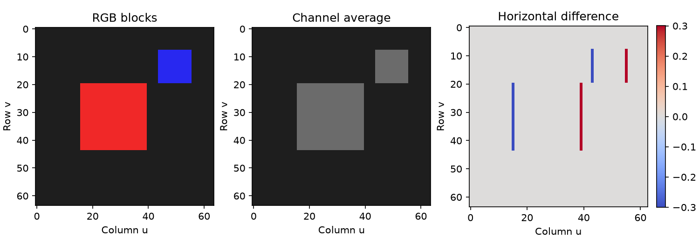

# 第 22 章　图像、像素与卷积

[上一章：让训练过程可排查、可复现](../21-training-engineering/README.md) · [全书目录](../../README.md) · 下一章：[第23章：卷积网络、视觉特征与迁移学习](../23-cnn-and-visual-representations/README.md)

**阅读顺序：正文 → [练习](exercises.md) → [参考答案](solutions.md)。**

## 让图片成为一张有结构的数字表

第16章输入只有三个颜色数，第20章输入是两个坐标。现在要给模型一整张图像。先修是数组维度、矩阵运算、PyTorch张量；本章不要求你已经知道相机原理。

你会生成一张带红蓝方块的图片，保存、读回、检查像素，再用小窗口算出边缘。这里的卷积核由我们手工指定，下一章再让网络通过训练学习卷积权重。

## 1. 像素、通道、分辨率

**像素**像马赛克画里的一小格。准确地说，是数字图像空间采样网格上的一个位置，其数值记录颜色或亮度等信息。灰度图每个位置常有一个数，RGB图每个位置有红、绿、蓝三个通道数。

**通道**可以想成同一张地图上的不同测量层；RGB的三个通道不是三张不相关照片，而是同一位置的三种颜色分量。**分辨率**在本章表示图像的宽和高，例如宽64、高48，一共3072个像素；RGB数组则有 $48\times64\times3$ 个通道数值。

常见8位图像使用无符号整数 `uint8`，范围0到255。例如纯红常写 `(255,0,0)`，黑 `(0,0,0)`，白 `(255,255,255)`。并非所有图像都是8位RGB：深度图可能用浮点距离，透明图还有alpha通道，读取前需要确认数据约定。

不要直接在uint8里做负数差值：固定范围整数可能溢出或回绕。图像算法通常先转换成浮点，再做减法和卷积。

## 2. 图像坐标不是桌面坐标

在常见图像数组中，左上角是起点，行号向下增加，列号向右增加。访问通常写 `image[row, col]`，即 `image[v,u]`，其中 $u$ 是横向像素坐标，$v$ 是纵向像素坐标。与第10章横轴右、纵轴上的数学平面相比，纵向方向不同。

像素(30,20)只说明图中的位置，不能直接说物体在桌面上右移30厘米、前移20厘米。像素位置如何对应真实空间，还依赖相机位置、镜头、物体深度等；后面的机器人坐标与传感器章节会补齐。

Pillow图像的 `.size` 返回 `(宽,高)`，而转成NumPy数组后 `.shape` 常为 `(高,宽,通道)`。如果你用宽高不相等的图片做一次检查，就更容易发现混淆。

## 3. 读图、缩放与布局转换

**Pillow**是Python图像读取和处理库，导入名为 `PIL`。一个清楚的RGB读取流程是：

```python
with Image.open(path) as image:
    array = np.array(image.convert("RGB"), dtype=np.float32) / 255.0
```

`convert("RGB")` 明确约定三通道，`/255` 把本例8位像素缩放到0到1。这只是数值范围缩放，不等于第12章的均值方差标准化。若预训练模型要求特定均值、标准差或颜色顺序，必须按它的约定处理。[Pillow 教程](https://pillow.readthedocs.io/en/stable/handbook/tutorial.html)

**缩放图像**就是把网格改成另一个大小。最近邻方法取附近一个原像素，容易出现块状边缘，但适合不应混合类别编号的标签图；双线性方法将邻近像素按距离加权，颜色更平滑，却可能混合边界。缩小时还需考虑抗混叠，即避免细纹理错误地变成另一种图案。

RGB的NumPy布局常是HWC（Height、Width、Channels），PyTorch卷积常用NCHW（批量、通道、高、宽）：

```python
tensor = torch.from_numpy(array).permute(2, 0, 1).unsqueeze(0)
```

`permute(2,0,1)` 重新排列轴，把HWC变为CHW；`unsqueeze(0)` 在最前面加长度为1的批量轴。这里不能随意 `reshape` 成同样形状，因为reshape不会按颜色含义交换各轴数据。

## 4. 卷积核是一把滑动的小尺子

**卷积核**像一张带数字的小模板，放在图上某个小区域，对应格子相乘再加起来；滑到下个位置继续算。输出形成**特征图**，即每个位置对某种局部模式的响应。

单通道、步长1、不填充时，核 $K$ 大小 $k_h\times k_w$，输入 $X$，输出：

$$
Y_{i,j}=\sum_{a=0}^{k_h-1}\sum_{b=0}^{k_w-1}K_{a,b}X_{i+a,j+b}.
$$

下标 $i,j$ 是输出位置，$a,b$ 是小窗口内部位置。同一套核权重在所有位置复用，叫**权重共享**：检测同一种边缘时不用为图上每个位置另学一份规则。

严格数学里的卷积会翻转核；深度学习库通常执行上式这种不翻转核的**互相关**，习惯仍称卷积。本书与PyTorch约定一致。[D2L 图像卷积](https://d2l.ai/chapter_convolutional-neural-networks/conv-layer.html)

手算输入与核：

$$
X=\begin{bmatrix}1&2&3\\4&5&6\\7&8&9\end{bmatrix},\qquad
K=\begin{bmatrix}1&0\\0&-1\end{bmatrix}.
$$

左上输出 $1\times1+2\times0+4\times0+5\times(-1)=-4$；其余三个窗口分别是 $2-6,4-8,5-9$，都为−4。得到 $2\times2$ 输出。

用核 `[1,-1]` 沿水平方向比较相邻像素。平坦区域两个数相等，响应0；遇到亮暗边界出现正或负响应。因此它常用于显现竖直边缘：计算的是横向变化，边缘本身常是竖直的。符号保留变化方向，绘图不能直接把负数转uint8丢掉。

## 5. 步长、填充与输出大小

**步长**stride是模板每次移动几个像素；步长2会跳过部分位置。**填充**padding是在图像外围临时补一些数，例如补0，让边界也能参与更多窗口。

对高度 $H$、核高 $k$、两边各填 $p$、步长 $s$，不使用空洞时：

$$
H_{out}=\left\lfloor\frac{H+2p-k}{s}\right\rfloor+1.
$$

$\lfloor\cdot\rfloor$ 是向下取整，因为只能放下完整窗口。宽度同理。比如输入32、核3、填充1、步长1，输出32；步长2时输出16。输入5、核3、不填充、步长2，则输出2。

**空洞率**dilation可以理解为让核的相邻采样点之间留空，扩大观察跨度而不增加权重数。若空洞率 $d$，有效核大小变为 $d(k-1)+1$，代入上式即可；本章代码用 $d=1$。[PyTorch Conv2d](https://docs.pytorch.org/docs/2.14/generated/torch.nn.Conv2d.html)

填充不是凭空得到真实边界外的信息。补0可能制造人造边缘，反射或复制填充有不同假设，应说明采用哪一种。

## 6. 多通道卷积与参数量

RGB图有3个输入通道，一个输出通道的卷积核需要分别处理3个通道，再相加：

$$
Y_{o,i,j}=b_o+\sum_{c=1}^{C_{in}}\sum_{a,b}W_{o,c,a,b}X_{c,i+a,j+b}.
$$

$o$ 是输出通道编号，$c$ 是输入通道编号；一个输出通道可以响应某种颜色与空间模式的组合。对普通 `groups=1` 卷积，权重形状为 $(C_{out},C_{in},k_h,k_w)$，含偏置参数量：

$$
C_{out}C_{in}k_hk_w+C_{out}.
$$

3输入通道、8输出通道、3×3核，共 $8\times3\times9+8=224$ 个参数，无论输入是32×32还是64×64，参数数目都不变。但输出特征图和计算量会随图像尺寸变化。

## 7. 感受野与池化

**感受野**像一个输出单元能看见的原图窗口。准确地说，是能影响该输出的输入区域。单个3×3卷积看3×3区域；连续两个3×3、步长1卷积，第二层一个位置能受到原图5×5区域影响。边缘处一部分区域可能来自填充。

有步长时可以跟踪两个数：观察跨度 $r$ 和相邻输出在原图中的间隔 $j$。从 $r=1,j=1$ 开始，每层核大小 $k$、步长 $s$、空洞率1时，更新 $r_{new}=r+(k-1)j$，$j_{new}=js$。这样不必靠猜测深层网络看多大区域。

**池化**像把一个小区域压缩成一个代表数。最大池化取最大值，平均池化取均值。例如窗口 $\begin{bmatrix}1&3\\2&4\end{bmatrix}$，最大池化为4，平均池化为2.5。它通常没有可学习参数。

池化减少空间尺寸和部分细节，可以带来一定局部容忍，但不是任意平移下输出绝对不变。对精确定位任务，丢掉太多位置信息可能有害。下一章会用不同输出头分别处理类别与位置。

## 8. 方块图片与边缘实验

```bash
python chapters/22-images-and-convolution/examples/image_convolution.py
```

脚本生成64×64图像，保存PNG，再读回核对形状和像素；用简单的通道平均生成灰度数值，仅用于本例，不当作标准色彩亮度转换。用自写NumPy窗口运算与PyTorch `conv2d` 对照，最后生成下图。



左侧是原RGB图，中间是通道平均，右侧是水平差分的有符号响应。平坦区域接近0，方块左右边缘呈相反符号。绘图使用正负对称的色阶，颜色并不对应原物体颜色。

代码中的 `torch.nn.functional.conv2d` 直接应用给定权重，不自行建立可学习层；`nn.Conv2d` 则把权重注册成模块参数，适合下一章训练。脚本中手工核没有经过学习。

## 过关标准

能在HWC和NCHW间正确转换；能指出像素坐标的方向与单位；能手算小卷积并推算输出尺寸、参数量；能解释感受野和池化的信息损失。掌握这些后再开始训练视觉特征，不必现在研究复杂检测网络。

---

[上一章：让训练过程可排查、可复现](../21-training-engineering/README.md) · [全书目录](../../README.md) · 下一章：[第23章：卷积网络、视觉特征与迁移学习](../23-cnn-and-visual-representations/README.md)
