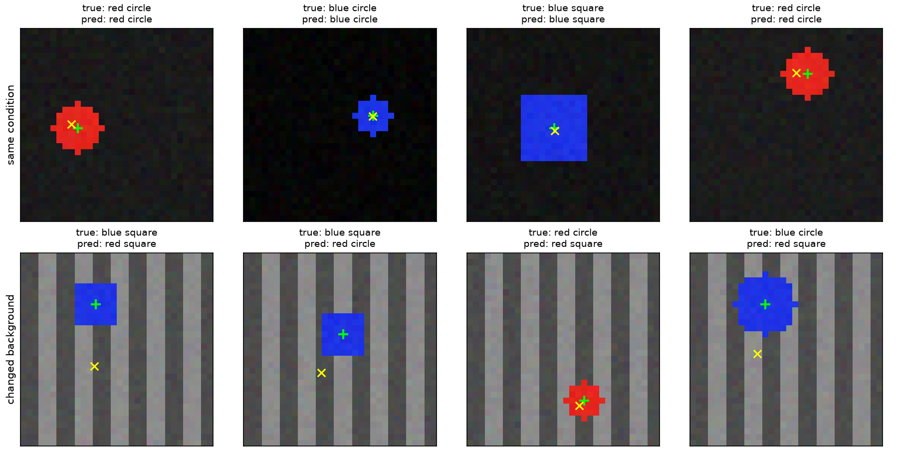

# 第 23 章　卷积网络、视觉特征与迁移学习

[上一章：图像、像素与卷积](../22-images-and-convolution/README.md) · [全书目录](../../README.md) · 下一章：[第24章：NLP 入门：文字怎样变成数字](../24-text-tokenization-and-embeddings/README.md)

**阅读顺序：正文 → [练习](exercises.md) → [参考答案](solutions.md)。**

## 把手工卷积变成可以学习的特征

第22章的边缘核由人指定，现在让数据决定卷积权重。**卷积神经网络**（Convolutional Neural Network，CNN）就是包含可学习卷积层的神经网络，常把卷积、激活、下采样与输出层组合起来。所谓“端到端训练”，是最终任务损失通过反向传播共同调整中间特征提取与输出参数，而不是只训练最后一层。

本章先修是图像布局、卷积尺寸、交叉熵、回归损失、PyTorch训练循环和验证集。任务是看一张32×32的合成图片，判断红色/蓝色与方形/圆形组成的四种类别，并估计物体中心。

## 1. 特征提取器与任务头

**视觉特征**可以理解为从像素中整理出来的有用线索，准确地说，是图像经过模型后得到的中间表示。它可以是带空间维度的特征图，也可以是一个向量。

**骨干网络**或特征提取器负责产生这些中间表示；**任务头**是把表示变成某种具体答案的小模块。本章共用同一特征提取器，接两个头：分类头输出4个logit，位置头输出2个坐标。

| 阶段 | 输出形状（批量B） | 用途 |
|---|---|---|
| 输入 | B×3×32×32 | RGB图像 |
| 3×3卷积3→8、填充1、ReLU | B×8×32×32 | 提取局部模式 |
| 2×2最大池化、步长2 | B×8×16×16 | 减少空间尺寸 |
| 3×3卷积8→16、填充1、ReLU | B×16×16×16 | 组合局部特征 |
| 2×2最大池化 | B×16×8×8 | 压缩特征图 |
| 展平、线性层到64、ReLU | B×64 | 共享特征向量 |
| 分类头 | B×4 | 颜色形状类别 |
| 位置头与sigmoid | B×2 | 归一化中心坐标 |

**展平**是把每个样本的多维特征整理成一维向量，批量轴仍保留。这里16×8×8=1024。我们保留空间排列后再接线性层，是为了让位置头仍能利用位置；不能一边过早平均掉所有空间信息，一边期待它自然保留精确坐标。

## 2. 同时学类别与位置，损失怎么组合

标签类别按红方、红圆、蓝方、蓝圆编码为0、1、2、3。图像横坐标 $u$ 向右、纵坐标 $v$ 向下，中心标签归一化为：

$$
c=(u/31,v/31).
$$

因为32像素的索引范围是0到31。位置头输出 $\hat c\in(0,1)^2$，本章中心被限制在画面内部，用sigmoid约束符合数据范围。

分类用交叉熵 $L_{cls}$，位置用平均坐标平方误差：

$$
L_{pos}=\frac1{2B}\sum_{i=1}^{B}\|\hat c_i-c_i\|_2^2,\qquad
L=L_{cls}+5L_{pos}.
$$

系数5是本实验预先固定的损失权重，用于平衡两个目标的数值尺度，不是通用常数。共享卷积层收到两个头的梯度之和，这正是第19章多路径梯度累积。

分类准确率和位置误差要分别报告。位置指标采用平均像素欧几里得距离：$\frac1B\sum_i31\|\hat c_i-c_i\|_2$。它与坐标MSE不同，不能把一个指标的数值当另一个。

## 3. 数据协议在训练前写清楚

训练512张、验证128张、同条件测试128张，分别用独立种子100、101、102生成。每个场景独立选择类别、位置、大小与轻微像素噪声，训练背景是较暗、近似均匀的灰色。不是从同一段视频抽相邻帧拆分。

另设128张背景变化测试，种子103，把背景换成更亮的条纹。物体生成规则相同，但背景超出训练条件。训练预算25轮、Adam学习率0.003、小批量32，使用验证集总损失选择最佳轮次；两份测试都只在方案和最佳模型确定后评估。

基线也事先确定：分类始终选训练多数类，位置始终预测训练中心均值。它们只从训练数据取得常数。

这套协议回答“在这份合成渲染规则下，独立新图像和指定新背景上表现如何”。它不覆盖真实照片、透明物体、遮挡、多物体、透视或相机噪声。模型在本章的能力范围应与这些条件一起报告。

## 4. 分类、定位、检测、分割的答案不同

**图像分类**回答整张图属于什么类别。**定位**回答一个目标在哪里，例如中心或矩形框。**目标检测**需要找出数量可能变化的多个目标，为每个给出类别、位置和置信度。**分割**则逐像素描述区域：语义分割给类别，实例分割还区分同类别的不同物体。

**边界框**像在物体周围画一个矩形，常用 $(x_{min},y_{min},x_{max},y_{max})$ 表示。本章的中心预测只给2个数，没有预测大小，因此不是完整的边界框检测系统。

**交并比**（Intersection over Union，IoU）是两个区域重合多少的分数：

$$
\operatorname{IoU}(A,B)=\frac{|A\cap B|}{|A\cup B|}
=\frac{|A\cap B|}{|A|+|B|-|A\cap B|}.
$$

这里 $|\cdot|$ 表示面积。采用连续矩形坐标或半开像素区间时，宽为 $x_{max}-x_{min}$，不额外加1；其他约定必须明确。矩形A=(0,0,4,4)、B=(2,2,6,6)，各面积16，交集4，IoU=4/28=1/7。

分类正确不意味着IoU高，框接近也不意味着类别正确。一个拿错物体但位置很准的机器人，仍然没有完成任务。本章同时报告类别和中心误差正是为了避免把这两件事混成一个成功指标。

## 5. 残差连接：给信息留一条直接道路

更深的网络不一定更容易训练。**残差连接**像让一个模块只负责提出对原结果的修改，同时保留原来的信息。典型形式：

$$
y=x+F(x).
$$

$F$ 是若干可学习层，输出形状必须与 $x$ 相同才能逐元素相加；若不相同，可用可学习投影 $P(x)$ 调整，再写 $y=P(x)+F(x)$。

反向传播时，一条路径经过 $F$，另一条直接经过加法中的 $x$，因此梯度可以沿直接分支传播。它有助于优化深网络，但不保证任意深度、任意配置都稳定。ResNet是这一思路的经典视觉模型家族。[ResNet 原论文](https://arxiv.org/abs/1512.03385)

本章小CNN没有残差块，先理解和训练基础结构。后面的Transformer也会用到残差连接，所以这不是只属于图像的技巧。

## 6. 预训练、冻结与微调

**预训练**像先学会看大量图片里的常见模式，再去学一个新任务；准确地说，是先在某数据和目标上学习参数，再把这些参数用于后续任务的起点。**迁移学习**是将已有任务获得的表示或参数用于新任务。

**冻结**指不更新某些参数，例如对骨干参数设置 `requires_grad_(False)`，只训练新的任务头。它不自动切换BatchNorm或Dropout模式，固定特征提取器时还要明确其模式和运行统计处理。

**微调**是用新任务数据继续更新已有参数，可以只更新部分层，也可以更新整个网络。常从较小学习率开始，并在验证集上选配置。先前训练有帮助需要任务和数据足够相关，不保证总优于从零训练。

输入预处理、通道顺序、像素范围、缩放裁剪和权重版本必须匹配预训练模型。只复制权重而忽略输入约定，结果可能很差。[PyTorch 迁移学习教程](https://docs.pytorch.org/tutorials/beginner/transfer_learning_tutorial.html)

## 7. 经典项目入口：TorchVision

[pytorch/vision](https://github.com/pytorch/vision) 是PyTorch官方视觉工具项目，提供图像变换、模型和数据集接口，适合从小CNN过渡到经典视觉网络。核验日期2026-10-24。

建议先看仓库的模型目录与ResNet实现，再按官方迁移学习教程练习“冻结骨干、替换分类头”，最后做小规模微调。运行时TorchVision与PyTorch版本必须兼容，应根据官方对应关系建立独立环境，记录权重标识、预处理和下载来源。

本章主实验只用已安装的PyTorch、NumPy和Matplotlib，未安装或运行TorchVision，也未下载预训练权重。官方项目是下一步选学入口；CPU可以读代码和做小推理，完整大数据训练的资源需求远高于本章，不能把本章耗时当作它的预算。

## 8. 运行与读图

```bash
python chapters/23-cnn-and-visual-representations/examples/train_vision.py
```

脚本生成全部数据、训练、选择验证最佳参数、评测两份测试，并保存权重、JSON报告、逐轮日志和预测示例图。图中绿色加号表示真实中心，黄色叉号表示预测中心；标题显示真实类别与预测类别。



看图时不要只挑成功样本。示例按测试集固定前4张展示，未根据预测正确与否挑选。整体指标与该图共同帮助发现问题，具体运行数值见[检查记录](validation.md)。

本次实际结果如下，两个测试集各128张，模型由验证集选出第25轮：

| 条件 | 模型类别准确率 | 多数类基线 | 模型平均中心误差 | 均值中心基线 |
|---|---:|---:|---:|---:|
| 与训练相同的背景规则 | 89.06% | 32.81% | 1.055像素 | 6.969像素 |
| 新的亮条纹背景 | 25.78% | 30.47% | 7.046像素 | 7.082像素 |

模型在原规则下学到了有用关系，但对这类背景变化明显不稳健；变化背景上分类还低于多数类基线。这里保留失败结果，不用这份测试继续调参。下一版若要改进，可以在新的训练和验证方案里加入合理背景变化，再准备新的独立测试；一次失败本身尚不能唯一定位网络究竟依赖了哪些线索。

## 过关标准

能追踪CNN每层形状和两个头的输出；能区分分类、中心回归、检测与分割；会计算简单IoU；知道预训练、冻结与微调各改变什么；能写出对新背景的独立评测。下一章转入NLP，从文字的数字表示开始，为之后VLM理解指令做准备。

---

[上一章：图像、像素与卷积](../22-images-and-convolution/README.md) · [全书目录](../../README.md) · 下一章：[第24章：NLP 入门：文字怎样变成数字](../24-text-tokenization-and-embeddings/README.md)
