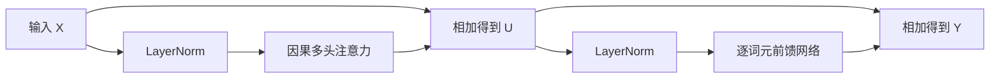

# 第 27 章　从注意力搭建 Transformer

[上一章：注意力机制：从相关性到信息聚合](../26-attention/README.md) · [全书目录](../../README.md) · 下一章：[第28章：训练自己的小型语言模型](../28-tiny-language-model/README.md)

**阅读顺序：正文 → [练习](exercises.md) → [参考答案](solutions.md)。**

## 注意力只是模块中的一部分

第26章已经能实现注意力，但完整Transformer还需要明确词元位置、稳定中间数值、进行逐位置非线性变换，并把信息跨层传递。本章把这些部件逐个接上，所有内容都依赖已经学过的向量、归一化、残差、MLP和因果预测。

**Transformer**是一类以注意力和逐位置前馈网络等组件构成的序列模型架构。本章实现一个用于自回归语言建模的简化decoder模块，不宣称复现某个商业大模型或原始论文全部配置。

## 1. 内容一样，位置也应该能不同

如果不加位置信息，对同一组输入做没有因果限制的自注意力，调换输入顺序会使输出相应调换，而不会自然知道“这是第一个词”。这叫**置换等变性**：重排输入，输出也以同样方式重排。

因果掩码会引入“能看哪些过去位置”的结构，但它和明确的位置表示解决的问题不同。掩码限制可见性，位置表示告诉模型某词元在序列什么位置，两者不能简单互相替代。

**位置编码**像给每块词元积木贴一个位置标签。设词元嵌入 $E[x_t]$，位置向量为 $p_t$，模型输入是 $X_t=E[x_t]+p_t$。二者同维，后续网络从混合表示中学习内容和位置的用途。

位置向量可以直接作为可学习参数，也可以用固定公式。本章使用正弦编码，模型维度d取偶数：

$$
p_{t,2i}=\sin\left(\frac{t}{10000^{2i/d}}\right),\qquad
p_{t,2i+1}=\cos\left(\frac{t}{10000^{2i/d}}\right),
\quad i=0,\ldots,d/2-1.
$$

t从0开始。不同维度使用不同变化速度，像用多把周期不同的尺子共同标识位置。它不要求现在学习傅里叶分析。t=0时偶数位置为0、奇数位置为1。固定公式可计算更长位置，但不保证模型在未训练长度上表现可靠。[Transformer 原论文](https://arxiv.org/abs/1706.03762)

## 2. LayerNorm沿着一个词元自己的特征做归一化

**层归一化**（Layer Normalization，LayerNorm）像对每个词元自己的那串数字重新定中心、换尺度。对某个词元向量 $x\in\mathbb R^d$：

$$
\mu=\frac1d\sum_jx_j,\qquad
v=\frac1d\sum_j(x_j-\mu)^2,
\qquad
\mathrm{LN}(x)_j=\gamma_j\frac{x_j-\mu}{\sqrt{v+\epsilon}}+\beta_j.
$$

$\gamma,\beta$是长度d的可学习缩放与偏移，$\epsilon$防止除零。本章对形状(B,T,d)使用 `nn.LayerNorm(d)`，只沿最后的d个特征统计，不跨样本、不跨时间。

它和第21章BatchNorm不同：本章LayerNorm不依赖其他样本组成什么批次，也不维护供评估切换使用的运行均值；通常训练和评估采用同样的归一化规则。整个网络里若还有Dropout，仍需要区分train/eval。[LayerNorm 原论文](https://arxiv.org/abs/1607.06450)；[PyTorch接口](https://docs.pytorch.org/docs/2.14/generated/torch.nn.LayerNorm.html)

不要在语言预测中无意沿整段时间一起计算统计，否则未来词元可能通过均值影响过去位置，即使注意力mask正确也会泄漏。

## 3. 前馈层不是又一次跨词元注意力

**前馈网络**（Feed-Forward Network，FFN）在Transformer中通常是每个词元独立使用同一套小MLP：

$$
\mathrm{FFN}(x)=\phi(xW_1+b_1)W_2+b_2.
$$

中间维度 $d_{ff}$ 通常大于模型维度d，先扩展再压回。输入(B,T,d)，中间(B,T,d_ff)，输出(B,T,d)。同一组参数作用于每个位置，但FFN本身不在不同位置之间传信息；跨位置交互由注意力完成。

本章激活函数用 **GELU**（Gaussian Error Linear Unit，高斯误差线性单元），可以先想成一个平滑的开关，不像ReLU在0处硬折一下。准确形式为 $\mathrm{GELU}(x)=x\Phi(x)$，$\Phi(x)$ 是标准正态变量小于等于x的概率，即标准高斯曲线左侧面积。它允许部分负值通过；代码使用 `nn.GELU()`。[PyTorch GELU](https://docs.pytorch.org/docs/2.14/generated/torch.nn.GELU.html)

你已在第12章学过正态分布与面积概率，因此不必提前背一个陌生的近似多项式才能理解这里的定义。

## 4. 两条残差支路组成一个block

**block（模块块）**可以先理解为重复搭建网络时的一组标准零件。我们采用先归一化再计算支路的Pre-LN结构：

$$
U=X+\mathrm{CausalAttention}(\mathrm{LN}_1(X)),
$$

$$
Y=U+\mathrm{FFN}(\mathrm{LN}_2(U)).
$$

两次相加要求形状始终是(B,T,d)。第23章讲过的残差直接路径让原有信息和梯度能绕过支路传播；支路负责学习需要加入的变化。

原始Transformer常描述为支路计算、相加后再归一化的Post-LN结构；本书选择Pre-LN便于小模型训练与讲解，不能把两种顺序混写。这里只实现基本架构，不引入更多变体。



堆叠多个block后，通常再接最终归一化和线性词表输出层，得到(B,T,V)的logit。最后一维对应第24章词表，下一个词元交叉熵沿这维计算。

## 5. encoder、decoder、encoder-decoder各指什么

**编码器**（encoder）可以先理解为把输入整理成上下文表示的部分。典型Transformer编码器用双向自注意力，每个有效位置可看整段输入，适合对已知完整文本做分类或表示提取。

**解码器**（decoder）在架构语境中是逐步生成目标序列的部分。仅解码器模型（decoder-only）使用因果自注意力，根据已有前缀预测下一个词元。这里的decoder不是第24章“ID还原文本”的那个简单函数，两者名字相同但工作层次不同。

**编码器—解码器**结构先用encoder理解输入，再由decoder生成输出；decoder除了因果自注意力，还可用交叉注意力查看encoder输出。例如翻译时输入原文已经全部已知，输出译文则逐步生成。

模型是否能看双向上下文取决于任务和掩码，不是某个类名自动保证。图像表示也可用编码器式结构，后面ViT章节会沿用这个区分。

## 6. 参数量与上下文成本

本章d维注意力包含Q/K/V三个d→d投影、一个d→d输出投影，含偏置共 $4d^2+4d$ 个参数。FFN从d到f再回d，参数 $2df+f+d$。两个LayerNorm各有缩放和偏移，共4d。因此单block总计：

$$
4d^2+2df+9d+f.
$$

取d=16、f=64，结果3280。头数4，每头4维；在总d固定、标准投影形式不变时，改头数不改变以上参数量。位置编码是固定缓冲，不算可学习参数。

**上下文长度**是模型一次可处理的词元位置数量，限制来自架构配置、内存和训练分布。普通密集注意力分数表随T平方增长；FFN工作量大致随T线性增长、随d和f的乘积增长。写成 $O(T^2d)$ 或 $O(Tdf)$ 时，O只是描述规模扩大时主要增长趋势，不是精确耗时公式。

本章实现没有KV缓存，生成时若反复重算前缀，会有重复计算。缓存与更高效实现属于后续工程扩展，不能让优化技巧掩盖基础因果关系。

## 7. 最小block实现与检查

```bash
python chapters/27-transformer/examples/transformer_block.py
```

代码将Q/K/V一次线性投影为3d，再沿最后一维 `chunk(3, dim=-1)` 切成三份；拆头后沿最后两轴计算注意力，因果布尔表用 `tril()` 生成。预先生成的正弦位置表通过 `register_buffer` 保存为模型状态，但不进入优化器参数列表。

脚本用两个样本、5个位置、16维输入，核对block输出形状与3280个参数，并对标量测试目标做一次反向，检查所有参数梯度有限。然后只改最后一个输入词元，前四个位置输出应保持不变。

这里的输出尚未训练，不展示“理解语言”的结论。位置编码、LayerNorm和FFN已经就位，下一章才给它真正的词元序列和训练目标。

## 过关标准

能复述一个Pre-LN block的数据流；能解释位置编码与因果mask各自职责；能说清LayerNorm统计轴；会计算本章参数量；能区分三种编码器/解码器结构。到此，训练一个小型语言模型的必要部件已经按顺序齐备。

---

[上一章：注意力机制：从相关性到信息聚合](../26-attention/README.md) · [全书目录](../../README.md) · 下一章：[第28章：训练自己的小型语言模型](../28-tiny-language-model/README.md)
