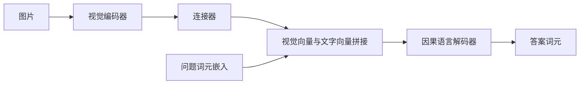

# 第 32 章　VLM：看图、读指令与生成回答

[上一章：图文对齐与 CLIP 思路](../31-multimodal-alignment/README.md) · [全书目录](../../README.md) · 下一章：[第33章：机器人在哪里：坐标系与位姿](../33-robot-frames-and-pose/README.md)

**阅读顺序：正文 → [练习](exercises.md) → [参考答案](solutions.md)。**

## 终于来到VLM

先学完图像编码、文字序列、Transformer、SFT与图文对齐，再读本章。**视觉语言模型（VLM）**像能同时读文字和看图片的答题者；准确地说，是联合处理视觉与语言信息的一类模型。广义上也包含第31章的图文双编码器；本章专门讨论能按文字条件生成答案的VLM。不同资料的术语范围可能不同，判断时看输入输出。

## 1. 三个部件怎样连起来

**视觉编码器**提取图片的向量表示。**连接器（projector）**像转接头，把视觉向量改成语言网络能接收的维度和表示；它常由线性层或MLP构成，但维度相同不保证语义已对齐，需要训练。**语言解码器**根据视觉、问题和已生成答案逐步预测下一个词元。

一种常见数据流是：



视觉输出(B,N,dv)，连接器后(B,N,d)，问题嵌入(B,T,d)，沿序列维拼接成(B,N+T,d)。视觉向量不一定对应文字词表中的ID；输入层可以直接接收它们。

另一方案用**跨注意力**：像答题者带着问题翻看图像笔记，Q来自文字隐藏表示，K、V来自视觉表示，形式仍为第26章的softmax(QKᵀ/√d)V。跨注意力不要求把图像当作文字ID。模型可以使用不同连接方式，不应把某一个实现当成VLM的唯一形式。

## 2. 训练时看什么、预测什么

设图像I、问题q、答案为 $a_1,\ldots,a_K$，训练目标是：

$$L=-\sum_{t=1}^{K}\log p_\theta(a_t\mid I,q,a_{<t}).$$

通常还把EOS纳入答案并做有效词元平均。视觉位置和问题位置不直接作为要预测的答案标签，但参与条件计算；答案位置使用因果限制。某些实现让视觉前缀内部双向可见，另一些沿用因果规则，必须读清代码。本章只有一个全图视觉向量，不存在多个视觉块相互遮挡的问题。

训练可以分阶段：先冻结视觉骨干和语言骨干，仅学连接器，让新输入接口可用；再用视觉指令数据更新指定模块。也可以联合训练，但小数据时有破坏已有能力的风险。**对齐训练**在这里指让两种表示能配合使用，不一定使用第31章CLIP对比损失。名称相同不代表目标公式相同。

## 3. 一个可以亲自跑完的微型流程

本章不是下载大型VLM，而是从随机参数训练一个受限问答模型。复用第31章12×12图形生成器；图片包含一种颜色和一种形状，问题只有“什么颜色？”和“什么形状？”。问题用两个专用词元表示，答案六个概念词元加EOS，因此没有通用中文理解。

图像经MLP编码为32维，连接器映射到32维；问题查表为32维；使用第27章的因果DecoderBlock。训练输入为 `[视觉, 问题, 正确答案]`：问题位置预测答案，答案位置预测EOS，视觉位置没有标签。生成时只输入 `[视觉, 问题]`，取得模型答案后重新输入 `[视觉, 问题, 生成答案]`，检查下一词是否EOS。

```bash
python chapters/32-vision-language-models/examples/visual_qa.py
```

固定种子7，Adam0.003，500次更新、每批36个问答。每批九种组合各两种问题各重复两次，图像独立生成。测试种子101，每组合20图，每图两问，共360问；训练和测试组合相同、图像实例不同。本章不把它称为未见组合评测，第31章已展示那是更难的问题。

所有模块联合训练，没有加载第28章语言权重：极小受限词表和任务用于清楚展示接口。不要把“实现了视觉→连接器→解码器”写成“复现了大型预训练VLM”。

## 4. 怎么确认它真的看图

**消融实验**像逐个拿走某个零件看结果是否改变；准确地说，是有控制地移除或替换组件、输入或训练条件，以分析其作用。测试三个输入条件，并保留同一套原始答案：

| 条件 | 目的 | 注意事项 |
|---|---|---|
| 原图＋原问题 | 正常任务准确率 | 答案和EOS均正确才算对 |
| 全黑图＋原问题 | 图像缺失时表现 | 黑图可能超出训练分布 |
| 另一张图＋原问题 | 破坏图像答案配对 | 被换图可能碰巧有相同属性 |

代码同时计算“换图后的回答是否符合新图属性”。如果原答案准确率下降、新图答案准确率仍高，比单看遮图下降更能支持模型利用了图像。换图保持有效图像分布，也减少把任何异常输入当作视觉依赖证据的问题。

问题也必须有作用：同一图先问颜色再问形状，答案应来自不同概念集合。代码报告两类问题各自准确率，避免多数题型掩盖少数题型失败。

## 5. 幻觉与定位能力

**视觉幻觉**像看图说了图中根本没有的东西；准确地说，是输出中出现不受视觉证据支持的实体、属性或关系。语言上合理不代表图像中存在。数据偏见、图像分辨率不足、提示诱导等都可能导致这种现象。

本章闭集任务不包含“看不清/没有物体”标签；黑图时模型仍被迫选词，不能据此声称它具备拒答能力。若要允许不确定回答，需要合适数据、目标和单独评测，不能只写一句提示保证可靠。

颜色问答也不等于定位。**视觉定位（grounding）**是把语言所指的实体与图像区域等视觉证据对应起来；可用框、点或掩码表达，并以IoU、像素误差等指标评价。物理抓取还需要坐标、动作和控制，接下来从第33章开始补这些基础。

## 经典案例与过关

[LLaVA论文](https://arxiv.org/abs/2304.08485)与[官方项目](https://github.com/haotian-liu/LLaVA)适合按“视觉塔→投影→语言模型→答案标签”的顺序阅读。先核对具体版本的冻结策略和输入预处理，再理解训练流程。本书没有运行其大模型训练；本章只验证自编CPU流程，结果见[检查记录](validation.md)。

过关要求：画出每一步形状；指出谁接收视觉梯度；解释因果和标签两种掩码；设计换图对照；明确受限问答、通用VLM与机器人行动之间仍缺哪些知识。

---

[上一章：图文对齐与 CLIP 思路](../31-multimodal-alignment/README.md) · [全书目录](../../README.md) · 下一章：[第33章：机器人在哪里：坐标系与位姿](../33-robot-frames-and-pose/README.md)
