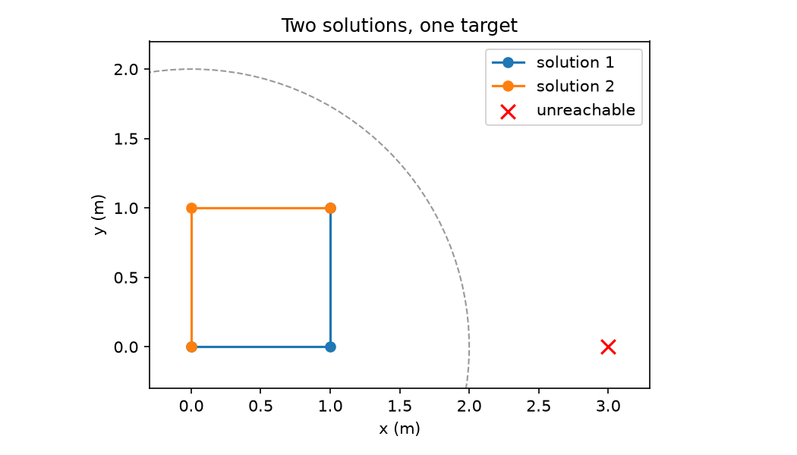

# 第 34 章　机器人怎样到达目标：运动学

[上一章：机器人在哪里：坐标系与位姿](../33-robot-frames-and-pose/README.md) · [全书目录](../../README.md) · 下一章：[第35章：运动、时间与反馈控制](../35-dynamics-and-feedback-control/README.md)

**阅读顺序：正文 → [练习](exercises.md) → [参考答案](solutions.md)。**

## 先用两根杆理解机械臂

本章只讨论平面几何，不涉及力。两根杆长L₁、L₂，单位米；第一关节角q₁相对基座x轴，第二角q₂相对第一根杆，单位弧度。第二杆相对基座的角是q₁+q₂，不是q₂。关节变量组成 $q=[q_1,q_2]^T$。

**运动学**像研究骨架怎么摆动而暂时不管肌肉用多大力，是研究构型、位置、速度之间几何关系的学科。**正运动学**从关节配置算末端位姿；**逆运动学（IK）**反过来，从目标位姿寻找符合要求的关节配置。

## 1. 正运动学是向量相加

先求肘部，再加第二杆方向：

$$x=L_1\cos q_1+L_2\cos(q_1+q_2),\qquad y=L_1\sin q_1+L_2\sin(q_1+q_2).$$

末端朝向为q₁+q₂。如果任务只要求(x,y)，有两个约束；再要求任意朝向会有三个约束，两关节一般无法独立满足。不要把“到达一点”和“以指定姿态到达一点”当成同一个问题。

L₁=L₂=1，q₁=0、q₂=π/2时，肘部(1,0)，末端(1,1)。这个可手算例子是代码的第一项核对。

## 2. 为什么逆解会有两个

令目标到基座距离 $r=\sqrt{x^2+y^2}$，由三角形边长关系：

$$c_2=\cos q_2=\frac{x^2+y^2-L_1^2-L_2^2}{2L_1L_2},$$
$$q_2=\pm\arccos c_2,\qquad q_1=\operatorname{atan2}(y,x)-\operatorname{atan2}(L_2\sin q_2,L_1+L_2\cos q_2).$$

**atan2(y,x)**像根据横纵坐标判断指针完整朝向，是能区分象限的反正切函数；仅用arctan(y/x)会丢失象限并在x=0时出问题。

正负号通常给出“肘上/肘下”两解。单位杆到(1,1)可以是(0,π/2)，也可以是(π/2,−π/2)。理想无关节限制时，可达距离范围是 $|L_1-L_2|\le r\le L_1+L_2$。边界两解可能重合；等长杆到原点有特殊退化情形，第一关节可以有无穷多取值。

浮点误差可让本应为1的c₂变成1+很小误差，所以先带容差判可达，再将c₂裁到[-1,1]。不能无条件把所有数裁进去，否则会把真正不可达的目标伪装成可达。实际还要检查关节限位、碰撞和工具偏移，本章没有模拟这些约束。

## 3. Jacobian把关节速度变成末端速度

第13章讲过多输出函数的偏导矩阵，现在把它用于 $p=f(q)$：

$$J(q)=\begin{bmatrix}
-L_1\sin q_1-L_2\sin(q_1+q_2)&-L_2\sin(q_1+q_2)\\
L_1\cos q_1+L_2\cos(q_1+q_2)&L_2\cos(q_1+q_2)
\end{bmatrix},\qquad \dot p=J(q)\dot q.$$

点号表示对时间求导；关节速度为弧度/秒，末端速度为米/秒。小变化近似 $\Delta p\approx J\Delta q$，不是任意大角度变化都精确。

**奇异位形**像手臂完全伸直后，瞬间无法靠微小转角沿手臂方向移动；准确地说，是Jacobian的秩低于该机构通常可达到的最大秩。这里 $\det J=L_1L_2\sin q_2$，伸直或折叠时为0。奇异点不等于所有方向都不能动，只是部分瞬时方向丢失。

## 4. 数值逆解怎样一步步靠近

给当前关节q，误差 $e=p_{target}-f(q)$。直接求 $J^{-1}e$ 在奇异附近可能产生很大角度变化。**阻尼最小二乘**像宁可每次走小一点，也不让脆弱方向把步子放大到失控，是加入更新大小惩罚的线性近似求解：

$$\min_{\Delta q}\|J\Delta q-e\|^2+\lambda^2\|\Delta q\|^2,$$
$$\Delta q=J^T(JJ^T+\lambda^2I)^{-1}e.$$

λ>0控制阻尼。代码使用 `np.linalg.solve` 解线性系统，不显式求逆；每次再限制更新范数≤0.2弧度。重复计算新位置、误差、Jacobian，直到误差足够小或达到迭代上限。若失败，要报告失败，不能只返回最后一组角度当作成功。

它仍是局部算法，初值、限位、碰撞和目标都会影响结果。阻尼不保证必定收敛，例如在完全伸直处要求沿杆缩短，线性模型的可用方向可能无法启动该更新，换一个轻微弯曲的初值才能避开这种局部困难。

## 5. 运行、观察与经典来源

```bash
python chapters/34-robot-kinematics/examples/kinematics.py
```

程序核对两组解析解、有限差分Jacobian、数值迭代、奇异秩，以及(3,0)不可达目标；生成[机械臂示意图](figures/arms.png)。数值记录见[检查记录](validation.md)。图上两个不同肘部都指向同一目标，红叉位于工作半径之外。



深入参考[Modern Robotics数值逆运动学](https://modernrobotics.northwestern.edu/nu-gm-book-resource/6-2-numerical-inverse-kinematics-part-1-of-2/)和[奇异位形](https://modernrobotics.northwestern.edu/nu-gm-book-resource/5-3-singularities/)。这里推导的是二维位置任务，不能原样替代一般六维机械臂位姿求解。

过关要求：不看代码写出正解；解释q₂的参考方向；拒绝不可达目标；说明Jacobian是局部速度关系；区分“求出关节角”和“机器人如何随时间到达这些角度”。后一问题进入下一章。

---

[上一章：机器人在哪里：坐标系与位姿](../33-robot-frames-and-pose/README.md) · [全书目录](../../README.md) · 下一章：[第35章：运动、时间与反馈控制](../35-dynamics-and-feedback-control/README.md)
