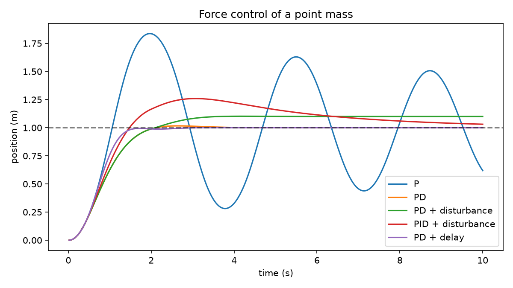

# 第 35 章　运动、时间与反馈控制

[上一章：机器人怎样到达目标：运动学](../34-robot-kinematics/README.md) · [全书目录](../../README.md) · 下一章：[第36章：相机、传感器与动作数据](../36-sensors-and-robot-data/README.md)

**阅读顺序：正文 → [练习](exercises.md) → [参考答案](solutions.md)。**

## 从“该到哪里”到“怎样动过去”

第34章只求关节几何。本章先把机器人简化为水平移动的一个小滑块。**动力学**像研究推小车时用多大力、车会怎样加速，是描述力与运动变化关系的学科。点质量模型忽略形状和转动，只保留质量m、位置x、速度v。

## 1. 位置、速度、加速度和单位

速度是位置变化率 $v=dx/dt$，单位米/秒；加速度是速度变化率 $a=dv/dt$，单位米/秒²。质量m用千克，力u用牛顿，基本关系为 $ma=F$。**惯性**就是物体保持当前运动状态的倾向，并不是一股额外的力。

考虑阻尼力−bv和外部扰动力d：

$$\dot x=v,\qquad \dot v=(u-bv+d)/m.$$

b单位牛顿·秒/米。它描述速度越大阻力越大的一种简化，不代表所有摩擦。给定净力2牛顿、质量1千克，加速度2米/秒²；不是每一秒必定移动2米，位移还取决于初始速度和时间。

**力矩**像扳手转动螺母的作用，表示力对转轴的旋转效应，常用单位牛顿·米；不等于直线力。一般机械臂动力学比这个点质量模型复杂，本章不提前展开质量矩阵等内容。

## 2. 连续时间怎样变成程序

**采样周期**是相邻控制计算之间的时间Δt，采样频率f=1/Δt。50Hz对应0.02秒，不能把50直接当时间步。

**积分**像把许多极小变化加起来，准确地说，是连续变化率的累积运算。位移 $x(t_1)-x(t_0)=\int_{t_0}^{t_1}v(t)dt$；程序用有限个小步近似。最直接的显式Euler更新为：

$$x_{k+1}=x_k+\Delta t\,v_k,\qquad
v_{k+1}=v_k+\Delta t\,(u_k-bv_k+d_k)/m.$$

两个右侧都使用旧时刻值。如果先更新v、再用新v更新x，就是另一种积分方案，结果可能不同。Δt太大可能造成数值不稳定，甚至让连续模型本来合理的控制器在仿真中发散。

手算：x₀=0、v₀=1、m=1、b=d=0、u=2、Δt=0.1，则x₁=0.1、v₁=1.2。第一步位置增量不直接使用新速度1.2。

## 3. 控制命令不是同一种数字

**控制器**像每隔一小会看一次车的位置再决定怎么推，是把目标和观测映射到控制命令的规则。位置命令、速度命令、力/力矩命令含义不同：

| 命令 | 例子 | 执行端需要做什么 |
|---|---|---|
| 目标位置 | 到x=1米 | 内部控制器生成速度或力 |
| 目标速度 | 向右0.2米/秒 | 跟踪速度，持续决定位置变化 |
| 力 | 向右施加2牛顿 | 根据动力学产生加速度 |

同样的数0.2不能跨接口直接使用。**闭环**表示动作持续依赖新观测；**开环**表示执行期间不根据新反馈调整计划。传感器有噪声和延迟，因此闭环并非自动稳定。

## 4. P、PD和PID逐项搭建

设目标位置为r，误差 $e_k=r-x_k$。**比例控制（P）**像离目标越远推得越用力，公式 $u=K_pe$。对于无阻尼质量，它可能来回振荡而不停止，不能把“方向对了”当成“会稳定到达”。

**微分控制（D）**像提前看到车还在快速冲向目标，赶紧减小推力。目标恒定时误差导数为−v，所以PD为 $u=K_pe-K_dv$。对位置噪声做差分会放大高频噪声，实际可能要滤波；本实验直接使用仿真中的速度。

**积分控制（I）**像记住“已经偏离目标很久”，补偿持续误差。误差累积 $I_{k+1}=I_k+e_k\Delta t$，PID为：

$$u_k=K_pe_k-K_dv_k+K_iI_{k+1}.$$

Kp单位牛顿/米，Kd单位牛顿·秒/米，Ki单位牛顿/(米·秒)，才能把三项相加。对恒定扰动d，PD在稳态v=0时通常保留 $e=-d/K_p$；积分项可在合适稳定条件下补偿这种偏差。

## 5. 饱和、积分累积和延迟

**饱和**像手的力气有上限，命令超范围时只能限幅；本实验把u裁到[-2,2]牛顿。**积分饱和累积（windup）**是执行器已经到上限，积分仍不断增加，后来误差反向也很难迅速消除的现象。本章采用简单的积分值裁剪[-0.8,0.8]米·秒，展示问题处理，不声称是适合所有系统的最优方案。

延迟意味着此刻根据旧位置控制。哪怕使用相同Kp、Kd，反馈相位和轨迹都会改变。增益越大并非越快越好；必须连同采样、饱和、噪声与动力学一起判断。

## 6. 实验先固定条件再比较

```bash
python chapters/35-dynamics-and-feedback-control/examples/control.py
```

m=1、b=0.2、目标1米、初始位置速度均0，Δt=0.02秒，共500步。固定Kp=4，PD/PID的Kd=3，PID的Ki=1。比较P、PD、PD加0.4牛顿持续扰动、PID加同样扰动、PD观测延迟10步（0.2秒）。扰动从2秒开始，命令均限幅；延迟模型只延迟观测，不额外延迟执行器。

记录末2秒位置均方根误差、最大超调、末速度。**超调**就是越过目标的最大程度；这里只统计目标正方向超过1米的最大距离。最后一点恰好接近目标不代表轨迹稳定，因此看整个末窗口以及速度。



[检查记录](validation.md)给出实际结果。本章是水平一维自编仿真，不连接机器人硬件。补充阅读：[Modern Robotics力/力矩输入的PD与PID控制](https://modernrobotics.northwestern.edu/nu-gm-book-resource/11-4-motion-control-with-torque-or-force-inputs-part-2-of-3/)。

过关要求是能手算一步更新、解释每个增益和单位、从轨迹辨认振荡与偏差。下一章把“观测”进一步拆成相机、深度、关节测量和时间戳。

---

[上一章：机器人怎样到达目标：运动学](../34-robot-kinematics/README.md) · [全书目录](../../README.md) · 下一章：[第36章：相机、传感器与动作数据](../36-sensors-and-robot-data/README.md)
