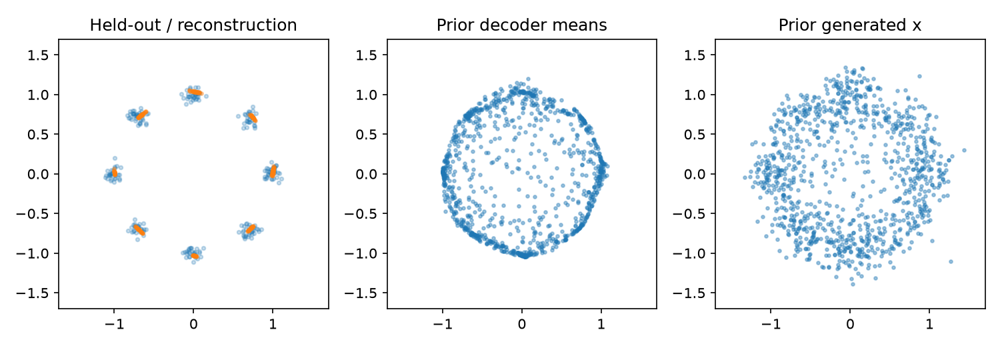

# 第 43 章　潜变量、自动编码器与 VAE

[上一章：先想几步再行动：规划与 MPC](../42-planning-and-mpc/README.md) · [全书目录](../../README.md) · 下一章：[第44章：扩散模型：从噪声逐步生成](../44-diffusion-models/README.md)

**阅读顺序：正文 → [练习](exercises.md) → [参考答案](solutions.md)。**

## 为什么在机器人课程里学习生成模型

第41章看到：同一情形可能有多种合理动作，平均动作未必合理。以后世界模型还需要表达未观察到的信息和多种可能未来。先从二维点学习“表示一个分布”，再进入动作与时序，避免直接把扩散、潜空间等术语堆在一起。

## 1. 压缩与重构

**自动编码器（AE）**像先用简短笔记描述一幅图，再根据笔记还原它，是由编码器 $z=f_\phi(x)$ 和解码器 $\hat x=g_\theta(z)$ 组成的网络。**潜变量z**像笔记中没有直接给定的内部描述，是模型用于解释或生成观测的隐藏变量或表示。它不必每一维都对应人能命名的物理量。

最简单AE最小化 $\|x-\hat x\|^2$。但重构训练只约束训练数据编码到的位置，潜空间其他区域可能没有训练支持；从任意高斯随机取z再解码，不保证得到像数据的样本。潜维较小也不自动保证保留任务关键信息。

## 2. 给潜变量明确的概率含义

**生成模型**像学会一种“出样本的规则”，是描述数据分布或采样过程的模型。VAE的生成过程先采样潜变量，再采样数据：

$$z\sim p(z),\qquad x\sim p_\theta(x\mid z),\qquad p_\theta(x)=\int p_\theta(x\mid z)p(z)\,dz.$$

p(z)称**先验**，在未看到当前x之前规定z的分布；看到x后根据贝叶斯规则得到 $p_\theta(z\mid x)$，称**后验**。积分是连续z上的累积，与离散变量求和对应。高维非线性解码器通常让精确后验难以计算，于是用可学习 $q_\phi(z\mid x)$ 近似它。

**变分自动编码器（VAE）**像让笔记本同时记录“可能的描述范围”，准确地说，是用近似后验与生成模型共同优化变分下界的潜变量模型。编码器输出分布参数，解码器输出条件数据分布参数，不仅是两个确定性压缩函数。

## 3. 下界从哪里来

连续分布KL写为 $D_{KL}(q\|p)=\int q(z)\log[q(z)/p(z)]dz$，它≥0，通常不对称。密度值可以超过1，但KL比较的是分布，不应把密度当离散概率。

把任意合适的q乘除进边缘似然：

$$\log p_\theta(x)=\log\mathbb E_{q_\phi(z\mid x)}\left[\frac{p_\theta(x,z)}{q_\phi(z\mid x)}\right]
\ge\mathbb E_q[\log p_\theta(x,z)-\log q_\phi(z\mid x)].$$

**Jensen不等式**在这里的直觉是：对log这种向下弯的函数，先平均再取log，不小于先取log再平均。用它得到的右边叫**证据下界（ELBO）**，是数据log似然的一个可优化下界。“证据”在此是观测数据的概率术语。

利用 $p_\theta(x,z)=p_\theta(x\mid z)p(z)$ 可整理为：

$$\mathcal L_{ELBO}=\mathbb E_q[\log p_\theta(x\mid z)]-D_{KL}(q_\phi(z\mid x)\|p(z)).$$

第一项鼓励能还原当前数据，第二项约束编码分布不要任意远离先验。更精确地，$\log p_\theta(x)-\mathcal L_{ELBO}=D_{KL}(q_\phi(z\mid x)\|p_\theta(z\mid x))$。这是为何称下界，而不是直接宣称已最大化精确似然。

## 4. 随机抽样怎样反向传播

取标准高斯先验 $p(z)=\mathcal N(0,I)$，近似后验为对角高斯 $q=\mathcal N(\mu,\operatorname{diag}(\sigma^2))$。**重参数化**像先抽一个固定规则的随机骰子，再用可微的变换调整结果：

$$\epsilon\sim\mathcal N(0,I),\qquad z=\mu+\sigma\odot\epsilon.$$

⊙为逐元素乘法。编码器输出μ和对数方差l=logσ²，因此σ=exp(l/2)。随机性放在独立于参数的ε，梯度仍可通过μ、σ到编码器。不能将“抽样”简单替换为 `z=mu.detach()`，那会切断需要的学习路径。

该高斯KL有闭式形式：

$$D_{KL}(q\|p)=\tfrac12\sum_j(\mu_j^2+\sigma_j^2-1-\log\sigma_j^2).$$

μ=0、σ=1时为0；一维μ=1、σ=1时为0.5。编码器若始终输出先验，KL很小，但z可能不再携带x信息，这种现象常称**后验坍塌**，不能仅凭KL低就判断模型好。

## 5. 重构误差必须和似然假设对应

本章解码器输出二维高斯的均值mθ(z)，观测标准差固定为σx=0.15：

$$-\log p_\theta(x\mid z)=\frac{\|x-m_\theta(z)\|^2}{2\sigma_x^2}+C.$$

C在固定方差下不影响梯度。训练最小化上述平方误差项加KL，先按数据维求和，再按批平均。若随意用不同维度的平均而不调整系数，就改变了重构与KL的相对权重。

有时人为把KL乘β；β=1对应本章该概率模型的负ELBO，β不等于1时一般是修改过的目标。不能在任意调权后仍声称严格优化同一个原始ELBO。

## 6. 二维环状混合分布实验

```bash
python chapters/43-latent-generative-models/examples/vae.py
```

自制数据为单位圆周上八个中心附近的二维高斯点，局部标准差0.06；训练1024点、测试256点，数据种子100/101。潜维2，编码器2→64→μ及log方差，解码器2→64→2。种子7、Adam0.003、1200步、批128、固定预算；不根据测试调参。

报告三件不同的事：用后验均值解码的测试重构MSE；随机后验样本的负ELBO估计（省略固定常数）；从先验采样z后生成的数据。生成图分别展示解码均值和加上观测噪声的真正x样本，不能把两者当成同一个分布。



本实验图中左面板蓝点是测试数据、橙点是后验均值重构。代码将log方差裁到[-8,8]以限制极端数值，这也是实现约束。

本实验潜维与数据维都为2，不用于证明降维压缩优势；它演示潜变量分布、重参数化和先验采样。八峰之间若被填平，保留现象并思考重构、先验匹配、模型容量和似然方差的关系。数值见[检查记录](validation.md)。

原始方法参考[Auto-Encoding Variational Bayes](https://arxiv.org/abs/1312.6114)。过关要求：分别写出先验、近似后验和解码分布；推导ELBO两项；说明重构一个输入与无输入随机生成的区别。下一章用另一种方式生成多峰分布：从噪声一步步去噪。

---

[上一章：先想几步再行动：规划与 MPC](../42-planning-and-mpc/README.md) · [全书目录](../../README.md) · 下一章：[第44章：扩散模型：从噪声逐步生成](../44-diffusion-models/README.md)
