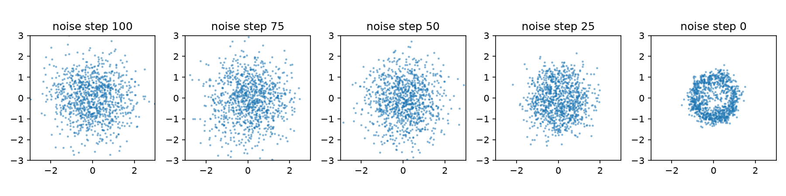

# 第 44 章　扩散模型：从噪声逐步生成

[上一章：潜变量、自动编码器与 VAE](../43-latent-generative-models/README.md) · [全书目录](../../README.md) · 下一章：[第45章：流匹配与连续生成](../45-flow-matching/README.md)

**阅读顺序：正文 → [练习](exercises.md) → [参考答案](solutions.md)。**

## 另一种生成思路

**扩散模型**像先把清晰图画逐渐弄模糊，再教网络辨认每一步加入的干扰，最后从随机噪声出发重建样本；准确地说，是构造逐步加噪过程，并学习相应反向生成过程的一类概率模型。这里的“时间”是生成过程的编号，不是机器人运动的真实时间。

先复习高斯分布、均方误差、梯度训练和第43章生成模型。本章实现二维点上的DDPM，不直接生成图片，避免网络结构掩盖概率过程。

## 1. 前向加噪

干净数据为x₀，步数t=1,…,T，选噪声强度βₜ∈(0,1)，令αₜ=1−βₜ：

$$q(x_t\mid x_{t-1})=\mathcal N(\sqrt{\alpha_t}x_{t-1},\beta_tI).$$

**噪声日程**像规定每一轮加入多少干扰，是β₁到β_T的序列。系数不是随便写的：保留旧信号的同时加入独立噪声，使标准高斯具有相应的稳定性。

定义累乘 $\bar\alpha_t=\prod_{s=1}^t\alpha_s$，反复代入后，独立高斯噪声可合并，得到：

$$x_t=\sqrt{\bar\alpha_t}\,x_0+\sqrt{1-\bar\alpha_t}\,\epsilon,\qquad\epsilon\sim\mathcal N(0,I).$$

因此训练时可以直接抽一个t生成x_t，不需要真的走完前t步。t越大且α累乘越小，数据贡献越弱。当 $\bar\alpha_T$ 足够小，末端分布近似标准高斯，但有限T时不一定严格相等。

手算：若 $\bar\alpha_t=0.64$、一维x₀=1、ε=−1，则x_t=0.8−0.6=0.2。注意系数是平方根，不是直接用0.64与0.36。

## 2. 网络到底预测什么

**去噪器**像根据当前脏图和脏到什么程度估计干扰，是输入x_t与t、输出预测量的网络。本章预测噪声 $\epsilon_\theta(x_t,t)$，最小化：

$$L_{simple}=\mathbb E_{x_0,t,\epsilon}\left[\|\epsilon-\epsilon_\theta(x_t,t)\|^2\right].$$

t均匀抽自1…T，x₀来自训练集，ε是新高斯噪声。程序按批和坐标维平均。这个简化目标与扩散概率模型的推导有关，但不是不加权就等于任意设置下的完整负log似然；不能拿训练MSE直接称为图像似然。

必须输入t，否则同一个x_t可能对应不同程度的噪声。代码将t/T以及两组sin/cos特征连接到二维x_t，再用两层64维MLP输出二维噪声。隐藏激活使用**SiLU**，可以理解为较平滑的门控，精确定义为x·sigmoid(x)；它不是扩散必需，只是本实验选择。

## 3. 反向采样一步怎样算

学习噪声后，可以先估计干净样本：

$$\hat x_0=(x_t-\sqrt{1-\bar\alpha_t}\,\epsilon_\theta)/\sqrt{\bar\alpha_t}.$$

DDPM用高斯反向转移，其中一种常见均值参数化为：

$$\mu_\theta(x_t,t)=\frac1{\sqrt{\alpha_t}}\left(x_t-\frac{\beta_t}{\sqrt{1-\bar\alpha_t}}\epsilon_\theta(x_t,t)\right).$$

本章选固定后验方差 $\tilde\beta_t=\beta_t(1-\bar\alpha_{t-1})/(1-\bar\alpha_t)$，约定 $\bar\alpha_0=1$。采样时：

$$x_{t-1}=\mu_\theta(x_t,t)+\sqrt{\tilde\beta_t}\,z,\quad z\sim\mathcal N(0,I).$$

从x_T标准高斯开始，t从T走到1；最后t=1的该方差为0，不再加随机噪声。不同实现可选其他方差或采样器，必须记录。不能把上式在训练时的目标噪声ε偷偷当作生成时已知量；生成只有网络预测。

代码数组下标0对应数学t=1，下标T−1对应t=T。检查这一点可避免把β、α累乘、时间输入错开一位。

## 4. 采样步数不能随便删

训练时每个样本只抽一个时刻，生成时要多次调用网络，这解释了“训练看起来单步，生成却慢”。原始DDPM相邻步公式假设从t到t−1；不能直接隔10步使用同一公式而称为有效加速。跳步需要匹配的采样推导或重新定义日程，相关方法为后续选学。

**条件生成**像在出图前告诉模型“画红色物体”，是学习 $p(x\mid c)$，让条件c进入去噪器 $\epsilon_\theta(x_t,t,c)$。c可为类别、文字表示、图像或机器人观测，且训练与生成时要约定一致。本章实际训练无条件分布；后续动作策略再输入观测条件。

用于图像时，去噪器常采用多尺度卷积或Transformer；改变的是网络如何处理高维数据，不能省略对噪声日程和目标的检查。二维实验不需要先学习复杂图像网络。

## 5. 与VAE使用相同的二维数据

```bash
python chapters/44-diffusion-models/examples/diffusion.py
```

复用第43章八峰分布与训练1024点（种子100）、测试256点（101）。T=100、β从0.0001线性增加到0.1，本例为二维小数据选择的日程，不建议直接复制为图像训练配置。Adam0.003、2000步、批128、种子7。没有测试选模，预算预先固定。

独立测试噪声MSE与预测全零基线一起报告；从种子102的1024个噪声点生成，画出剩余噪声编号100、75、50、25、0时的样本。由于评价的是分布，不能把随机生成点逐项对应测试点算MSE。报告到最近真实中心的平均距离、落在某中心0.2半径内的比例、八个中心各自覆盖数，三者联合看，防止只生成一个中心也获得低距离。



[检查记录](validation.md)给出实际结果。原始方法与历史实现见[DDPM论文](https://arxiv.org/abs/2006.11239)、[作者项目](https://github.com/hojonathanho/diffusion)。本章没有安装其原始框架或复现图像基准。

过关要求：独立写出直接加噪公式；区分真实ε与预测ε；说清训练与采样循环；解释时间条件；知道无条件二维点生成还不是动作策略或世界模型。下一章学习用连续速度场从噪声流向数据。

---

[上一章：潜变量、自动编码器与 VAE](../43-latent-generative-models/README.md) · [全书目录](../../README.md) · 下一章：[第45章：流匹配与连续生成](../45-flow-matching/README.md)
