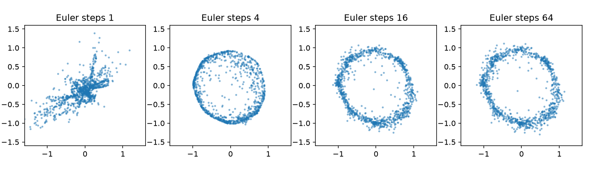

# 第 45 章　流匹配与连续生成

[上一章：扩散模型：从噪声逐步生成](../44-diffusion-models/README.md) · [全书目录](../../README.md) · 下一章：[第46章：动作序列、ACT 与生成式策略](../46-action-chunks-and-generative-policies/README.md)

**阅读顺序：正文 → [练习](exercises.md) → [参考答案](solutions.md)。**

## 从“预测噪声”换成“预测移动方向”

**流匹配（flow matching）**像给一群随机散落的点画出移动指示箭头，让它们逐渐排成数据的样子；准确地说，是通过回归指定概率路径的速度场来训练连续生成过程的方法。本章先学最简单的直线插值训练形式，不需要先会完整微分方程理论。

前置是第35章Euler更新和第44章生成过程。这里生成时间t从0到1，不是机器人执行动作的秒数；与上一章“干净数据x₀、噪声x_T”的下标约定不同，本章明确让x₀代表噪声、x₁代表数据。

## 1. 常微分方程与速度场

**速度场**像地图上每个位置都画一支箭头，是给定位置x和时间t返回变化率的函数v(x,t)。**常微分方程（ODE）**规定状态如何随一个时间变量变化：

$$\frac{dx}{dt}=v_\theta(x,t),\qquad x(0)\sim\mathcal N(0,I).$$

第35章已经用过同样思想；这里只是x为生成中的样本坐标。用N步显式Euler求解，Δt=1/N：

$$x_{k+1}=x_k+\Delta t\,v_\theta(x_k,k\Delta t).$$

网络调用N次。给定相同初始噪声与同一确定求解器，ODE采样是确定的；样本多样性来自不同初始噪声。这个说法不表示所有生成模型都只能使用确定过程。

## 2. 训练时构造一条容易知道答案的路

独立抽噪声x₀与真实数据x₁，再抽t均匀分布于[0,1]。构造直线桥：

$$x_t=(1-t)x_0+tx_1,\qquad u_t=x_1-x_0.$$

u是这对端点之间的恒定速度。比如x₀=(0,0)、x₁=(2,4)、t=0.25，x_t=(0.5,1)，速度(2,4)。这只是手工训练样例，不意味着实际学习后的采样轨迹都为直线。

训练目标为：

$$L_{CFM}=\mathbb E_{x_0,x_1,t}\|v_\theta(x_t,t)-(x_1-x_0)\|^2.$$

这里的**条件流匹配**首先是对已知端点条件下的路径构造回归目标，不必已经有文字提示条件。多个端点对可能经过相似的(x_t,t)，给出不同速度；平方损失学到的最优输出是该位置时间条件下的平均速度。它形成总体概率分布的流动，通常不是保存某个噪声与某个训练样本的一一配对。

本章采用独立端点配对，不实现最优传输耦合。不能把任意直线插值训练都称为已求得最优传输路线。

## 3. 训练与生成分别用什么信息

训练知道真实x₁，才能生成x_t和监督速度；采样不知道目标样本x₁，只知道初始噪声及学习到的速度场。若生成循环继续使用真实x₁来计算速度，就是把答案泄漏进生成，不能证明模型学会分布。

训练时每个样本只抽一个t，不需要数值积分完整路径；生成时才多步积分。噪声预测和速度预测的输出形状可以完全一样，却代表不同目标，不能只因都是二维向量就互换权重与采样公式。

若外部条件c是文字或机器人观测，可输入 $v_\theta(x_t,t,c)$，并从对应条件下的数据x₁采样训练。第46章以后再把x₁具体替换为动作序列。本章保持无条件，以免同时引入太多变量。

## 4. 与扩散的关系和差别

第44章DDPM使用离散加噪过程和带随机项的反向采样；本章使用直线条件路径、速度回归和确定ODE积分。二者都把简单噪声分布变成复杂数据分布，都可以使用相似神经网络。

更一般的理论把一些扩散路径、速度场和确定采样联系起来，因此不能概括成“扩散永远随机，流匹配永远比扩散快”。速度取决于模型、训练、采样器、精度要求和数据；较少网络调用不自动保证同等质量。基础方法见[Flow Matching for Generative Modeling](https://arxiv.org/abs/2210.02747)。

## 5. 相同训练预算，不同积分步数

```bash
python chapters/45-flow-matching/examples/flow.py
```

仍用前两章相同1024训练点和256测试点，数据种子100/101。网络与第44章保持同样宽度、时间特征和参数量，初始化种子7，Adam0.003、批128、2000次更新。目标变成端点差速度；相同更新数不等于所有优化难度和算力完全相等。

训练完成后从同一组1024噪声点分别用1、4、16、64步Euler采样。只改积分步数，不为各步数重新训练。报告到最近中心距离、0.2半径内比例、各峰覆盖以及本机采样耗时。速度回归测试MSE用于检查训练目标，与第44章噪声MSE含义不同，不能横向比较数值大小判断谁更好。



[检查记录](validation.md)记录实际结果。步数增加可以减小数值离散误差，但不能修复网络学错的速度场。若64步与16步差异很小，说明当前误差可能主要不是积分精度；这是需要进一步对照的推断，不是仅凭一张图确定原因。

过关要求：手算直线桥与目标速度；区分训练端点和采样未知目标；写出Euler循环；解释样本随机性来源；能把“生成时间”和“机器人执行时间”分别标记。下一章终于把这些生成方法用于一段动作。

---

[上一章：扩散模型：从噪声逐步生成](../44-diffusion-models/README.md) · [全书目录](../../README.md) · 下一章：[第46章：动作序列、ACT 与生成式策略](../46-action-chunks-and-generative-policies/README.md)
