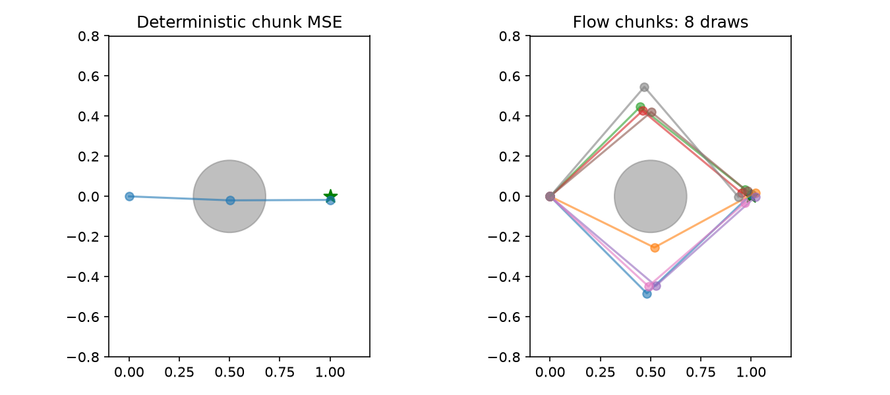

# 第 46 章　动作序列、ACT 与生成式策略

[上一章：流匹配与连续生成](../45-flow-matching/README.md) · [全书目录](../../README.md) · 下一章：[第47章：世界模型起步：学会预测下一步](../47-learned-dynamics/README.md)

**阅读顺序：正文 → [练习](exercises.md) → [参考答案](solutions.md)。**

## 一次预测一段动作

**动作块（action chunk）**像一次写好接下来几笔的画法，是模型同时预测的连续H步动作 $A_t=[a_t,\ldots,a_{t+H-1}]$，形状(H,d_a)。观测窗口长度、预测动作长度、真正执行的步数是三个不同参数。预测16步，可以只执行前4步再看新图，不必把16步全部执行。

动作块表达时间相关性，减少每一步独立作决定造成的抖动；长时间不重新观测又会错过扰动。第42章MPC搜索动作序列，第46章则由学习策略生成序列，二者都可以滚动执行，但生成策略不一定需要环境预测模型。

## 1. 平均动作为什么可能错误

想从(0,0)到(1,0)，中间(0.5,0)有障碍。专家一半从上方(0.5,0.4)绕过，一半从下方(0.5,-0.4)绕过。初始观测相同，第一步动作分别(0.5,0.4)、(0.5,-0.4)，均方误差最优均值为(0.5,0)，直接指向障碍。

把输出从一步改成两步但仍用确定性MSE，也可能平均整条路线。动作块长度与多峰表达是两个问题，不能把“输出序列”自动称为“能够选择一种完整合理模式”。

**模式一致性**像已经选上方路线就不要下一步突然切下方，是一段动作维持相容选择的性质。每步独立重新抽样可能在模式间跳变；保留一段生成序列、条件记忆或适当重新规划可以帮助，但各有取舍。

## 2. 条件VAE与ACT

第43章VAE可加入观测条件o。训练编码器 $q_\phi(z\mid A,o)$ 看真实动作块与观测，解码器 $p_\theta(A\mid z,o)$ 重构动作块，目标为重构损失加潜变量KL。部署时没有未来专家A，因此不能再用看过A的后验来生成。

**ACT**即Action Chunking with Transformers，可以理解为用Transformer学习一段动作，并用条件VAE形式组织示范中的变化。原始工作具体使用动作重构和KL训练；其推理采用固定潜变量设置，不能笼统说“ACT每次一定随机采样不同路线”。条件VAE框架允许表达变化，不保证某个固定推理规则会遍历所有模式。参考[ACT论文](https://arxiv.org/abs/2304.13705)与[作者代码](https://github.com/tonyzhaozh/act)。

**时间集成（temporal ensembling）**像把前几次计划对“现在这一步”的建议合并，是对不同起始时刻预测、但指向同一执行时刻的动作加权。若 $a_t^{(j)}$ 是第j次计划对时刻t的建议，则 $\bar a_t=\sum_jw_ja_t^{(j)}/\sum_jw_j$，权重与索引方向要明确。它不是把一个chunk里的不同时刻动作直接平均。

平滑并非总是合理：若混合上绕和下绕两种模式，平均仍可能撞障碍。使用时间集成前要检查动作语义、参考系及不同计划是否相容。

## 3. 扩散策略与流匹配动作头

**Diffusion Policy**把整段动作当作待生成的数据，使用当前或历史观测作为条件。训练对真实动作块加噪，让去噪器预测噪声；推理从动作噪声开始迭代生成，执行部分动作再重新观测。概念与第44章一致，数据从二维点变成H×d_a动作序列。

流匹配也可用 $A_\tau=(1-\tau)Z+\tau A$，回归速度 $A-Z$，条件为o。这里τ是生成时间，t是机器人执行时间，不能混为一条时间轴。归一化、填充动作的有效mask和轨迹边界都影响训练；不能让窗口跨两个回合。

[Diffusion Policy项目页](https://diffusion-policy.cs.columbia.edu/)与[官方仓库](https://github.com/real-stanford/diffusion_policy)提供经典案例。原始机器人基准有独立环境与资源要求，本章只运行自编CPU简化，不安装整个项目栈。

## 4. 双路径实验如何保持结论诚实

本章新建一个几何任务：起点(0,0)，目标g的x在[0.8,1.2]、y在[-0.1,0.1]米，圆障碍中心g/2、半径0.18米。动作是**位移增量**，与第37章速度命令不同。环境沿每个动作对应的整条线段检查碰撞，不允许端点越过障碍就被误判为成功。两步后距目标<0.12米且全程未碰撞才成功。这里做几何路径评测，发生碰撞即判失败；程序仍计算计划末点误差用于诊断，不表示物体真的能够穿过障碍继续执行。

训练256个目标，每个目标各有上绕、下绕两条专家路线，中间点g/2+(0,±h)，h在[0.35,0.55]。每对使用相同h以保持对称。测试是种子101生成的128个新目标，各重复8次，生成策略使用不同初始噪声，不能从8次中只选最好的一次。

比较三个学习器：逐步MSE-BC在每一步重新读取当前位置；确定性动作块MSE一次输出两步；条件流匹配一次生成两步并连续执行。三个模型均固定2000次更新、Adam0.003、批128，架构与推理成本不同，因此是现象演示而非全面算法排名。流匹配生成时用32次Euler调用，不用碰撞模型筛选样本，也不偷偷把末动作改为精确到达目标。

```bash
python chapters/46-action-chunks-and-generative-policies/examples/chunks.py
```

图显示固定目标(1,0)下的路线；数值评测使用全部测试目标。[检查记录](validation.md)会区分碰撞与末点不到位，不能把所有失败都归为“模式平均”。本实验没有中途扰动，生成chunk执行两步不代表具备真实闭环鲁棒性；下一阶段还要学习预测环境和更系统的闭环比较。



过关要求：算清动作块形状；区分预测与执行长度；解释后验在部署时为什么不可用；指出时间集成可能失败的情况；知道生成动作分布与预测环境未来不是同一件事。

---

[上一章：流匹配与连续生成](../45-flow-matching/README.md) · [全书目录](../../README.md) · 下一章：[第47章：世界模型起步：学会预测下一步](../47-learned-dynamics/README.md)
